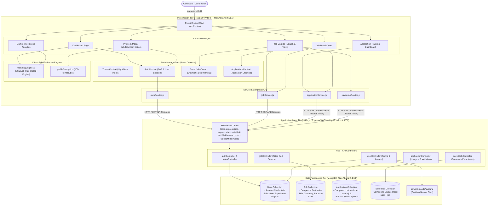

# CareerVista — Job Market Intelligence & Career Recommendation Platform

> **A deterministic, explainable career recommendation platform and job market intelligence system built with the MERN architecture.**

[](https://mongodb.com)
[](https://react.dev)
[](https://nodejs.org)
[](https://expressjs.com)
[](https://mongoosejs.com)
[](https://vite.dev)

---

## 1. Project Overview & Academic Objectives

The contemporary recruitment landscape is characterized by high data fragmentation and opaque algorithmic screening. Job seekers submit numerous applications through commercial portals without receiving actionable explanations regarding why opportunities are recommended or what specific technical proficiencies they lack. In parallel, conventional Applicant Tracking Systems (ATS) rely on proprietary "black-box" scoring, penalizing non-standard resumes and obscuring evaluation criteria.

**CareerVista** addresses these challenges through a full-stack, decoupled Web application developed using the **MERN architecture** (MongoDB, Express.js, React 19, Node.js). The platform replaces opaque heuristics with two transparent evaluation systems:
1. **Explainable 100-Point Job Matching Engine:** Computes candidate-job compatibility across three weighted, deterministic dimensions: **Technical Skills (60%)**, **Preferred Role Alignment (25%)**, and **Location Compatibility (15%)**.
2. **100-Point Profile-Strength Evaluator:** Evaluates candidate profile readiness across four developmental categories (Identity, Professional Positioning, Technical Validation, and Background History) mapped to five milestone tiers from *"Getting Started"* to *"All-Star Profile"*.

For the complete academic technical report and UML specifications, refer to [CareerVista NTCC Project Report](docs/CareerVista_NTCC_Project_Report_Revised.md) and [System Architecture Specification](docs/system-architecture.md).

---

## 2. Verified Technology Stack

All framework, library, and tool versions have been verified directly against `client/package.json` and `server/package.json`:

### Frontend (Client-Side)
- **Core Library:** React `^19.2.7` & React DOM `^19.2.7` (React 19 Hooks, concurrent rendering, StrictMode)
- **Build System & Dev Server:** Vite `^8.1.1` (Hot Module Replacement, ES Modules)
- **Client Routing:** React Router DOM `^7.18.1` (Declarative routing, Protected Route layouts)
- **UI Animation & Transitions:** Framer Motion `^12.42.2`
- **Iconography:** Lucide React `^1.27.0` & React Icons `^5.7.0` (FontAwesome, Material Design)
- **Styling Architecture:** Custom Vanilla CSS Design System with CSS Custom Properties (`:root` theme tokens)

### Backend (Server-Side)
- **Runtime Environment:** Node.js `>= 20.x` (CommonJS module system)
- **Web Application Framework:** Express `^5.2.1`
- **Object Data Modeling (ODM):** Mongoose `^9.9.5`
- **Authentication & Tokens:** jsonwebtoken `^9.0.3` (RFC 7519 JWT, 7-day expiration)
- **Password Encryption:** bcryptjs `^3.0.3` (10-round salted hashing)
- **Multipart Upload Pipeline:** Multer `^2.4.0` (Disk storage, MIME validation, 3MB limit)
- **Brute-Force Rate Limiting:** express-rate-limit `^8.7.0` (IP-based request quotas)
- **Cross-Origin Security:** cors `^2.8.6`
- **Configuration:** dotenv `^17.4.2`
- **Development Tooling:** nodemon `^3.1.14`

### Database & Storage
- **Database:** MongoDB Atlas / Local MongoDB Instance (BSON document storage, compound text and unique indexing)
- **File Storage:** Local server filesystem (`server/uploads/avatars/`) for candidate avatar media

---

## 3. System Architecture & Component Responsibilities

CareerVista operates as a **3-Tier Distributed System**:



---

## 4. Frontend-to-Backend Request Flow & API Directory

All client requests are dispatched through dedicated service modules in `client/src/services/` utilizing the native `fetch` API. Protected endpoints automatically inject authorization headers formatted as `Authorization: Bearer <token>`.

### REST API Endpoints Directory

| Method | Endpoint | Access Level | Description | Key Parameters / Payload |
| :--- | :--- | :--- | :--- | :--- |
| `POST` | `/api/auth/register` | Public (Rate Limited) | Registers new user account with bcrypt password hashing | `{ name, email, password }` |
| `POST` | `/api/auth/login` | Public (Rate Limited) | Authenticates credentials and issues 7-day signed JWT | `{ email, password }` |
| `GET` | `/api/auth/me` | Private (JWT Required) | Retrieves authenticated user profile and subdocuments | Header: `Bearer <token>` |
| `PUT` | `/api/auth/me` | Private (JWT Required) | Updates user profile and subdocuments | `{ name, headline, preferredRole, skills, bio, education, experience, projects, ... }` |
| `POST` | `/api/auth/profile-picture` | Private (JWT Required) | Uploads candidate avatar image (Multer, 3MB ceiling) | `multipart/form-data (profilePicture)` |
| `DELETE` | `/api/auth/profile-picture` | Private (JWT Required) | Deletes current avatar from disk and resets profile link | Header: `Bearer <token>` |
| `GET` | `/api/jobs` | Public | Retrieves active jobs with search, filtering, and sorting | Query: `?search=&location=&type=&experience=&sort=` |
| `GET` | `/api/jobs/:id` | Public | Retrieves single job document by MongoDB ObjectId | URL param: `id` |
| `POST` | `/api/jobs` | Private (JWT Required) | Creates a new job posting | Job attributes payload |
| `GET` | `/api/saved-jobs` | Private (JWT Required) | Retrieves all saved jobs for authenticated user | Header: `Bearer <token>` |
| `POST` | `/api/saved-jobs/:jobId` | Private (JWT Required) | Bookmarks a job (enforces compound unique index) | URL param: `jobId` |
| `DELETE` | `/api/saved-jobs/:jobId` | Private (JWT Required) | Un-bookmarks a job from user's saved list | URL param: `jobId` |
| `GET` | `/api/applications` | Private (JWT Required) | Retrieves all job applications submitted by candidate | Header: `Bearer <token>` |
| `POST` | `/api/applications/:jobId` | Private (JWT Required) | Submits job application (enforces compound unique index) | `{ fullName, email, resumeName, notes }` |
| `GET` | `/api/applications/:id` | Private (JWT Required) | Retrieves detailed record for single application | URL param: `id` |
| `PUT` | `/api/applications/:id` | Private (JWT Required) | Updates application lifecycle status | `{ status }` |
| `DELETE` | `/api/applications/:id` | Private (JWT Required) | Withdraws and deletes an application record | URL param: `id` |
| `GET` | `/api/health` | Public | Service healthcheck verification | None |

---

## 5. Database Schema & Data Models

CareerVista uses four core Mongoose entities in `server/src/models/`:

### 1. `User` Schema (`server/src/models/User.js`)
- **Account Identity:** `name`, `email` (unique, lowercase, trimmed), `password` (bcrypt hash), `role` (`jobseeker` | `employer` | `admin`).
- **Profile Data:** `phone`, `location`, `headline`, `preferredRole`, `skills` (`[String]`), `resumeUrl`, `profilePicture`, `bio` (max 1500 chars), `isFresher` (boolean).
- **Embedded Subdocuments:**
  - `education` (`[educationSchema]`): `degree`, `institution`, `fieldOfStudy`, `startYear`, `endYear`, `currentlyStudying`.
  - `experience` (`[experienceSchema]`): `jobTitle`, `company`, `employmentType` (Full Time, Part Time, Internship, Contract, Freelance), `startDate`, `endDate`, `currentlyWorking`, `description`.
  - `projects` (`[projectSchema]`): `name`, `description`, `technologies` (`[String]`), `projectUrl`, `githubUrl`.

### 2. `Job` Schema (`server/src/models/Job.js`)
- `title`, `company`, `location`, `type` (`Full Time`, `Internship`, `Hybrid`, `Part Time`, `Remote`), `salary`, `salaryNumeric` (for numeric sorting), `experience`, `skills` (`[String]`), `description`, `responsibilities`, `requirements`, `postedBy` (ref: `User`), `isActive` (boolean).
- **Compound Text Index:** `{ title: "text", company: "text", location: "text", skills: "text" }` supporting multi-field keyword search.

### 3. `Application` Schema (`server/src/models/Application.js`)
- `user` (ref: `User`), `job` (ref: `Job`), `fullName`, `email`, `resumeName`, `notes`, `status` (`Submitted`, `Applied`, `Under Review`, `Shortlisted`, `Rejected`, `Selected`), `appliedAt`.
- **Compound Unique Index:** `{ user: 1, job: 1 }` preventing duplicate applications by the same user to the same job.

### 4. `SavedJob` Schema (`server/src/models/SavedJob.js`)
- `user` (ref: `User`), `job` (ref: `Job`).
- **Compound Unique Index:** `{ user: 1, job: 1 }` preventing duplicate bookmarks.

---

## 6. Authentication & Security Controls

- **Stateless JWT Tokens:** Authentication is managed via RFC 7519 JSON Web Tokens signed with HMAC SHA-256 using `JWT_SECRET`. Tokens expire after 7 days.
- **Salted Password Hashing:** User passwords are encrypted with `bcryptjs` using 10 salt rounds before storage.
- **Strict Password Complexity:** Passwords must be 8–72 characters and contain at least one uppercase letter, one lowercase letter, one digit, and one special character.
- **Brute-Force Rate Limiting:** Powered by `express-rate-limit`:
  - `/api/auth/login`: Limited to 5 requests per 15 minutes per IP.
  - `/api/auth/register`: Limited to 10 requests per 15 minutes per IP.
- **Multipart Media Upload Security:** Handled by Multer disk storage:
  - Destination restricted to `server/uploads/avatars/`.
  - MIME-type whitelist: `image/jpeg`, `image/png`, `image/webp`.
  - Extension whitelist: `.jpg`, `.jpeg`, `.png`, `.webp`.
  - File size capped at 3 MB (`3 * 1024 * 1024` bytes).
  - Sanitized filenames prevent directory traversal (`avatar-${userId}-${timestamp}-${random}${ext}`).
  - Previous avatar files are automatically deleted upon update or removal.
- **NoSQL Query & Input Sanitization:**
  - Regex escaping helper `escapeRegex()` prevents Regular Expression Denial of Service (ReDoS) attacks on search inputs.
  - MongoDB ObjectIds are validated via `mongoose.Types.ObjectId.isValid()` before database operations.
  - Explicit payload sanitization restricts editable profile fields.

---

## 7. Job-Matching & Profile-Strength Methodology

### 7.1 Deterministic Job Matching Engine (`matchingEngine.js`)

Unlike black-box models, CareerVista computes match compatibility using a **transparent, 100-point formula**:

$$\text{Total Score } (0 - 100) = \text{Skills Score } (60) + \text{Role Score } (25) + \text{Location Score } (15)$$

1. **Profile-Readiness Pre-Condition:**
   $$\text{isMatchReady}(user) = (\text{user.skills.length} \ge 1) \land (\text{user.preferredRole.trim().length} > 0)$$
   If false, the engine returns score `0` with the label `"Profile Incomplete"` and prompts profile completion.
2. **Dimension 1: Skills Match (60 Points Max / 60% Weight):**
   - Compares candidate skills against job required skills using normalized, bidirectional substring matching (`userSkill === jobSkill || userSkill.includes(jobSkill) || jobSkill.includes(userSkill)`).
   - Formula: $\text{round}\left(\frac{\text{Matched Skills Count}}{\text{Total Job Skills}} \times 60\right)$.
   - Award neutral 30 points if user has skills and job specifies no explicit skills.
3. **Dimension 2: Preferred Role Alignment (25 Points Max / 25% Weight):**
   - Compares candidate's `preferredRole` (or `headline` fallback) with `job.title`.
   - Exact/substring match awards full 25 points.
   - Token overlap awards proportional score: $\max\left(15, \text{round}\left(\frac{\text{Common Tokens}}{\text{User Role Tokens}} \times 25\right)\right)$.
4. **Dimension 3: Location Compatibility (15 Points Max / 15% Weight):**
   - Awards 15 points if job or user is Remote, if user specified no location constraint (non-penalizing for flexible candidates), or if locations match/overlap.
   - On-site location mismatch awards 0 points.
5. **Compatibility Bands:**
   - **80 – 100:** Strong Match
   - **60 – 79:** Good Match
   - **40 – 59:** Partial Match
   - **0 – 39:** Low Match
6. **Diagnostic Feedback:** Computes itemized `matchedSkills` and `missingSkills` arrays, providing immediate skill-gap diagnostics.

### 7.2 Profile-Strength Rubric (`profileStrength.js`)

Candidate profile strength is evaluated across 12 criteria spanning 4 categories:

| Category | Criteria Evaluated | Points |
| :--- | :--- | :---: |
| **Identity & Contact (20 Pts)** | Full Name ($\ge 2$ chars), Valid Email, Phone ($\ge 7$ chars), Location ($\ge 2$ chars) | 5 pts each |
| **Professional Positioning (20 Pts)** | Headline ($\ge 5$ chars), Preferred Role ($\ge 2$ chars), Bio ($\ge 30$ chars) | 5, 10, 5 pts |
| **Technical Validation (35 Pts)** | Skills List (1-2 skills = 5, 3-4 skills = 10, 5+ skills = 15), Projects ($\ge 1$ valid project = 10), Valid Resume URL (10) | 15, 10, 10 pts |
| **History & Background (25 Pts)** | Education ($\ge 1$ valid degree/institution/startYear = 15), Experience ($\ge 1$ job/company OR `isFresher === true` = 10) | 15, 10 pts |
| **Total Completeness Score** | | **100 Pts** |

**Milestone Progression Tiers:**
- $\ge 90$: **All-Star Profile**
- $\ge 75$: **Advanced Profile**
- $\ge 50$: **Intermediate**
- $\ge 25$: **Basic Profile**
- $< 25$: **Getting Started**

---

## 8. Major Application Modules

1. **Authentication Module:** Registration, login, rate limiting, and JWT session persistence with route protection.
2. **Profile & Subdocument Management Module:** Full profile editor with interactive modals for adding, editing, and deleting Education, Experience, and Project records, alongside avatar upload and deletion.
3. **Job Catalog & Multi-Criteria Filtering Module:** Full-text search and faceted filters (location, job type, experience level, salary/company sorting).
4. **Job Matching & Recommendation Module:** Live scoring of active vacancies with skill-gap diagnostics and match score badges.
5. **Saved Jobs & Optimistic Bookmarking Module:** Instant client bookmarking with automatic server synchronization.
6. **Application Tracking & Lifecycle Module:** Six-state lifecycle tracker (`Submitted`, `Applied`, `Under Review`, `Shortlisted`, `Rejected`, `Selected`) with application withdrawal support.
7. **Market Intelligence & Analytics Module:** Aggregates real-time vacancy metrics, application conversion funnels, and live market skill demand from active database listings.

---

## 9. Installation & Local Setup

### Prerequisites
- **Node.js:** v20.x or higher
- **npm:** v10.x or higher
- **MongoDB:** Active local MongoDB instance or MongoDB Atlas connection URI

### Step 1: Clone the Repository
```bash
git clone <repository_url>
cd CareerVista
```

### Step 2: Configure and Start the Backend Server
```bash
cd server
npm install

# Create environment configuration file
cp .env.example .env
# Edit .env with your MongoDB URI and JWT Secret

# Seed database with sample active job vacancies
node src/scripts/seedJobs.js

# Start backend server in development mode
npm run dev
# Server will run at http://localhost:5000
```

### Step 3: Configure and Start the Frontend Client (New Terminal)
```bash
cd client
npm install

# Create frontend environment configuration
cp .env.example .env
# Ensure VITE_API_URL=http://localhost:5000

# Start Vite development server
npm run dev
# Client will run at http://localhost:5173
```

---

## 10. Required Environment Variables

### Backend Configuration (`server/.env`)
```ini
# Server Execution Port
PORT=5000

# Node Environment Mode
NODE_ENV=development

# MongoDB Connection String (Atlas URI or Local Instance)
MONGO_URI=mongodb://localhost:27017/careervista

# JWT Secret Key for HMAC SHA-256 Token Signing
JWT_SECRET=your_jwt_secret_key_change_in_production
```

### Frontend Configuration (`client/.env`)
```ini
# Backend API Base URL
VITE_API_URL=http://localhost:5000
```

---

## 11. Known Limitations & Future Improvements

1. **Local Media Storage:** Avatar images are stored on the server's local filesystem (`server/uploads/avatars/`). Future versions will support cloud object storage (e.g., AWS S3, Cloudinary).
2. **Resume OCR & Document Parsing:** Candidate resumes are currently referenced via HTTP/HTTPS links or document labels. Direct PDF/DOCX parsing via Optical Character Recognition (OCR) and NLP skill extraction represents a planned enhancement.
3. **Self-Service Employer Portal:** While backend APIs support job creation (`POST /api/jobs`), the current frontend is optimized for candidate job seekers. A dedicated recruiter dashboard is planned for future enterprise releases.
4. **Email Notification Pipeline:** Application status modifications currently update database records in real time; automated email dispatch via SMTP (Nodemailer/SendGrid) is deferred to future milestones.

---

## 12. Repository Structure

```
CareerVista/
├── client/                          # React 19 + Vite Frontend SPA
│   ├── src/
│   │   ├── components/              # Modular UI components (auth, dashboard, jobs, profile)
│   │   ├── config/                  # API base configuration (api.js)
│   │   ├── context/                 # React Contexts (Auth, SavedJobs, Applications, Theme)
│   │   ├── layouts/                 # MainLayout with Topbar and Sidebar
│   │   ├── pages/                   # Application Views (Dashboard, Profile, Jobs, Analytics, etc.)
│   │   ├── routes/                  # AppRoutes with ProtectedRoute guards
│   │   ├── services/                # API client services (auth, jobs, applications, savedJobs)
│   │   └── utils/                   # matchingEngine.js, profileStrength.js
│   ├── .env.example                 # Frontend environment template
│   └── package.json                 # Client dependencies (React 19, Vite 8, React Router v7)
├── server/                          # Express 5 + Node.js Backend API
│   ├── src/
│   │   ├── config/                  # Database connection (db.js)
│   │   ├── controllers/             # REST controllers (auth, user, job, application, savedJob)
│   │   ├── middleware/              # authMiddleware (JWT), uploadMiddleware (Multer)
│   │   ├── models/                  # Mongoose Schemas (User, Job, Application, SavedJob)
│   │   ├── routes/                  # Express route routers
│   │   ├── scripts/                 # seedJobs.js database seeder
│   │   ├── utils/                   # Server-side profileStrength.js
│   │   ├── app.js                   # Express application setup and middleware pipeline
│   │   └── server.js                # Server entrypoint and port listener
│   ├── uploads/                     # Upload directory for candidate avatars
│   ├── .env.example                 # Backend environment template
│   └── package.json                 # Server dependencies (Express 5, Mongoose 9, bcrypt, JWT)
├── docs/                            # Project Documentation & Academic Reports
│   ├── system-architecture.md       # Full System Architecture & Technical Specification
│   ├── CareerVista_NTCC_Project_Report_Revised.md # Comprehensive NTCC Minor Project Technical Report
│   └── CareerVista_Research_Paper.md# Academic research paper draft
└── README.md                        # Primary project documentation (this file)
```

---

## 13. Academic Documentation & Citations

This platform and its accompanying technical reports were developed as an academic Non-Teaching Credit Course (NTCC) Minor Project:
- **Comprehensive Project Report:** [docs/CareerVista_NTCC_Project_Report_Revised.md](docs/CareerVista_NTCC_Project_Report_Revised.md)
- **Detailed System Architecture:** [docs/system-architecture.md](docs/system-architecture.md)
