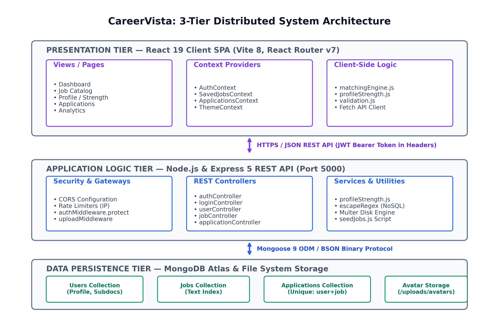
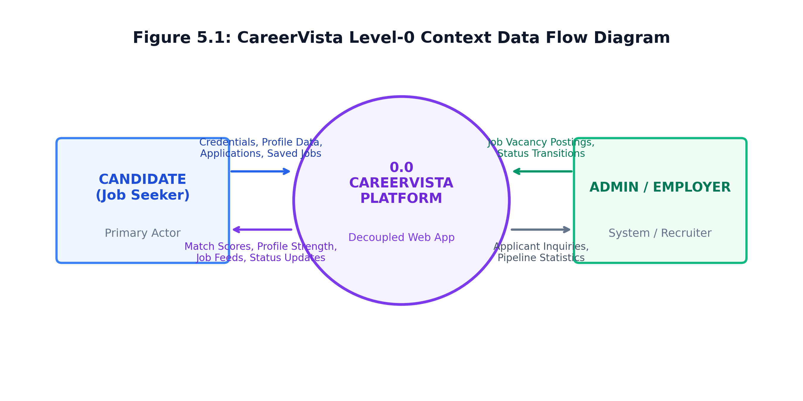
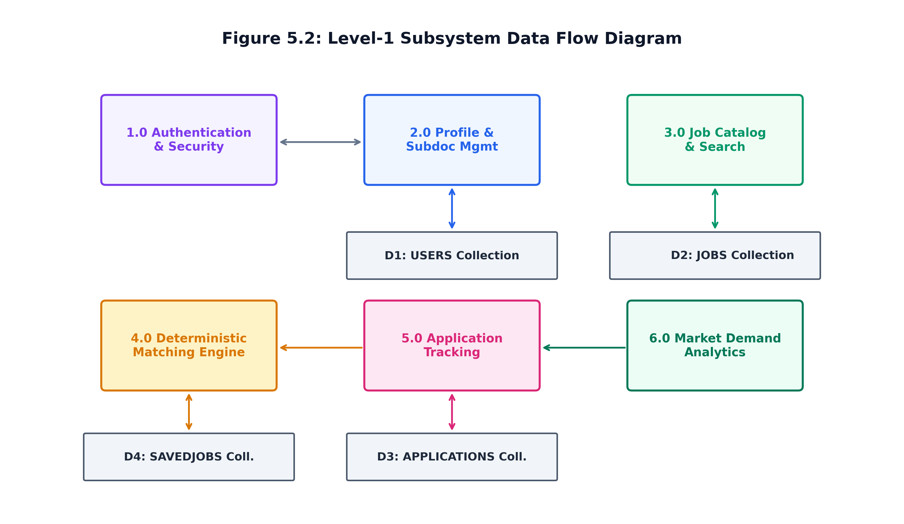
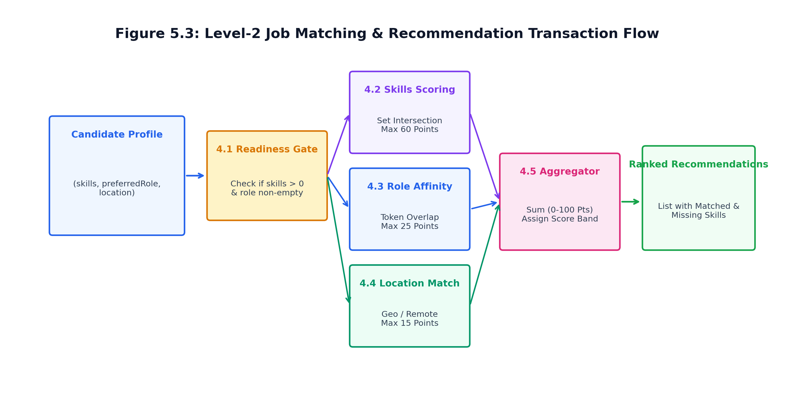
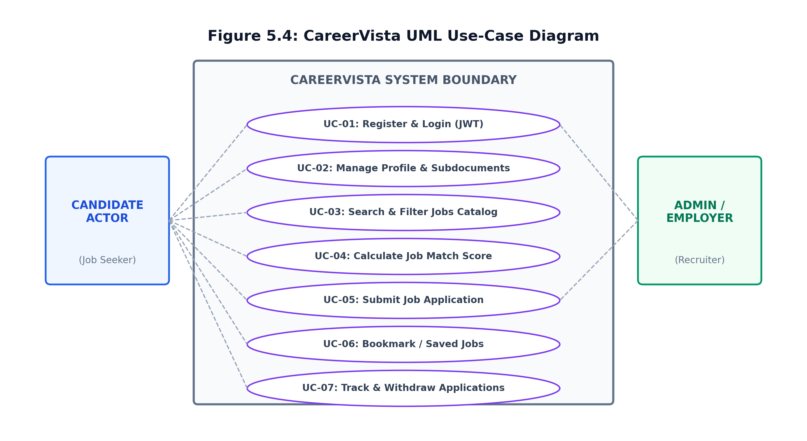
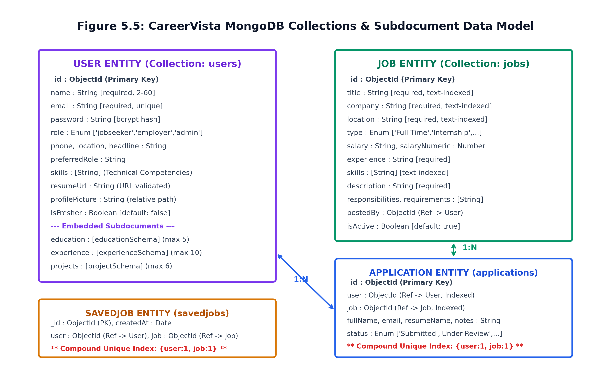
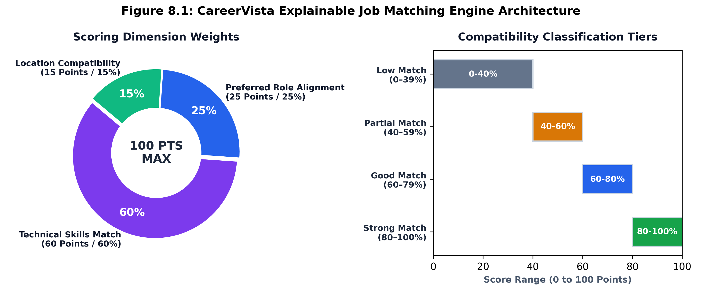
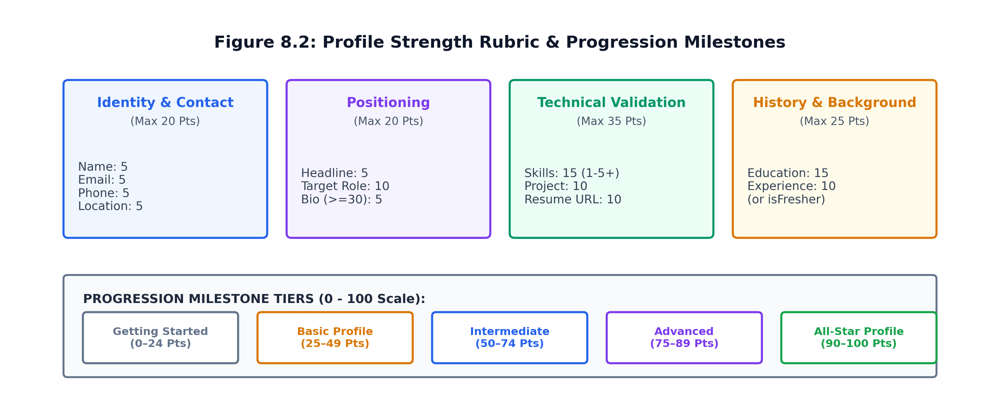

# CAREERVISTA: JOB MARKET INTELLIGENCE & CAREER RECOMMENDATION PLATFORM
## NON-TEACHING CREDIT COURSE (NTCC) MINOR PROJECT TECHNICAL REPORT

---

**Submitted in partial fulfillment of the requirements for the award of the degree of**
**[BACHELOR OF TECHNOLOGY / MASTER OF COMPUTER APPLICATIONS / DEGREE_NAME]**
**in**
**[COMPUTER SCIENCE AND ENGINEERING / INFORMATION TECHNOLOGY]**

---

### **Submitted By:**
**[STUDENT_NAME]**
**Enrollment No.:** [ENROLLMENT_NO]
**Roll No.:** [ROLL_NO]
**Semester / Year:** [SEMESTER_AND_ACADEMIC_YEAR]

### **Under the Guidance of:**
**[FACULTY_GUIDE_NAME]**
**[DESIGNATION_OF_FACULTY_GUIDE]**
**[DEPARTMENT_NAME]**

---

### **[NAME OF INSTITUTION / FACULTY OF ENGINEERING & TECHNOLOGY]**
### **[UNIVERSITY_NAME]**
**[CAMPUS_LOCATION, CITY, STATE, PIN_CODE]**
**Academic Session: [ACADEMIC_SESSION, e.g., 2025–2026]**

---

<div style="page-break-after: always;"></div>

## CERTIFICATE OF APPROVAL

This is to certify that the Non-Teaching Credit Course (NTCC) project report entitled **"CareerVista — Job Market Intelligence & Career Recommendation Platform"**, submitted by **[STUDENT_NAME]** (Enrollment No.: **[ENROLLMENT_NO]**), in partial fulfillment of the requirements for the award of the degree of **[BACHELOR OF TECHNOLOGY / DEGREE_NAME]** in **[COMPUTER SCIENCE AND ENGINEERING]** at **[NAME OF INSTITUTION / UNIVERSITY]**, is an authentic record of independent technical work carried out under my supervision and guidance.

To the best of my knowledge, the matter embodied in this project report has not been submitted to any other university or institute for the award of any degree or diploma.

<br><br><br>

----------------------------------------- &nbsp;&nbsp;&nbsp;&nbsp;&nbsp;&nbsp;&nbsp;&nbsp;&nbsp;&nbsp;&nbsp;&nbsp;&nbsp;&nbsp;&nbsp;&nbsp;&nbsp;&nbsp;&nbsp;&nbsp;&nbsp;&nbsp;&nbsp;&nbsp;&nbsp;&nbsp;&nbsp;&nbsp;&nbsp;&nbsp;&nbsp;&nbsp;&nbsp;&nbsp;&nbsp;&nbsp;&nbsp;&nbsp;&nbsp;&nbsp; -----------------------------------------
**[FACULTY_GUIDE_NAME]** &nbsp;&nbsp;&nbsp;&nbsp;&nbsp;&nbsp;&nbsp;&nbsp;&nbsp;&nbsp;&nbsp;&nbsp;&nbsp;&nbsp;&nbsp;&nbsp;&nbsp;&nbsp;&nbsp;&nbsp;&nbsp;&nbsp;&nbsp;&nbsp;&nbsp;&nbsp;&nbsp;&nbsp;&nbsp;&nbsp;&nbsp;&nbsp;&nbsp;&nbsp;&nbsp;&nbsp;&nbsp;&nbsp;&nbsp;&nbsp;&nbsp;&nbsp;&nbsp;&nbsp;&nbsp;&nbsp;&nbsp;&nbsp;&nbsp;&nbsp;&nbsp;&nbsp;&nbsp;&nbsp; **[HEAD_OF_DEPARTMENT_NAME]**
Project Supervisor / Guide &nbsp;&nbsp;&nbsp;&nbsp;&nbsp;&nbsp;&nbsp;&nbsp;&nbsp;&nbsp;&nbsp;&nbsp;&nbsp;&nbsp;&nbsp;&nbsp;&nbsp;&nbsp;&nbsp;&nbsp;&nbsp;&nbsp;&nbsp;&nbsp;&nbsp;&nbsp;&nbsp;&nbsp;&nbsp;&nbsp;&nbsp;&nbsp;&nbsp;&nbsp;&nbsp;&nbsp;&nbsp;&nbsp;&nbsp;&nbsp;&nbsp;&nbsp;&nbsp;&nbsp;&nbsp;&nbsp;&nbsp;&nbsp;&nbsp;&nbsp;&nbsp;&nbsp;&nbsp; Head of Department
[Department Name] &nbsp;&nbsp;&nbsp;&nbsp;&nbsp;&nbsp;&nbsp;&nbsp;&nbsp;&nbsp;&nbsp;&nbsp;&nbsp;&nbsp;&nbsp;&nbsp;&nbsp;&nbsp;&nbsp;&nbsp;&nbsp;&nbsp;&nbsp;&nbsp;&nbsp;&nbsp;&nbsp;&nbsp;&nbsp;&nbsp;&nbsp;&nbsp;&nbsp;&nbsp;&nbsp;&nbsp;&nbsp;&nbsp;&nbsp;&nbsp;&nbsp;&nbsp;&nbsp;&nbsp;&nbsp;&nbsp;&nbsp;&nbsp;&nbsp;&nbsp;&nbsp;&nbsp;&nbsp;&nbsp;&nbsp;&nbsp;&nbsp;&nbsp;&nbsp;&nbsp;&nbsp;&nbsp;&nbsp;&nbsp;&nbsp; [Department Name]
[Institution / University Name] &nbsp;&nbsp;&nbsp;&nbsp;&nbsp;&nbsp;&nbsp;&nbsp;&nbsp;&nbsp;&nbsp;&nbsp;&nbsp;&nbsp;&nbsp;&nbsp;&nbsp;&nbsp;&nbsp;&nbsp;&nbsp;&nbsp;&nbsp;&nbsp;&nbsp;&nbsp;&nbsp;&nbsp;&nbsp;&nbsp;&nbsp;&nbsp;&nbsp;&nbsp;&nbsp;&nbsp;&nbsp;&nbsp;&nbsp;&nbsp;&nbsp;&nbsp;&nbsp;&nbsp;&nbsp;&nbsp; [Institution / University Name]

<br>

**Date:** [DATE_OF_SUBMISSION]
**Place:** [CITY_NAME]

---

<div style="page-break-after: always;"></div>

## CANDIDATE DECLARATION

I, **[STUDENT_NAME]**, Enrollment No. **[ENROLLMENT_NO]**, student of **[DEGREE_NAME]** in **[COMPUTER SCIENCE AND ENGINEERING]** at **[NAME OF INSTITUTION / UNIVERSITY]**, hereby declare that the NTCC Minor Project report titled **"CareerVista — Job Market Intelligence & Career Recommendation Platform"** is an authentic and original work undertaken by me during the academic term **[ACADEMIC_SESSION]**.

I confirm the following:
1. The technical design, database schemas, algorithmic models, and implementation presented in this report represent my own work under the supervision of **[FACULTY_GUIDE_NAME]**.
2. Due academic credit and references have been provided for all external libraries, standards, and research literature consulted.
3. No part of this report has been plagiarized or submitted previously for any academic degree, diploma, or certificate.
4. I assume full responsibility for the technical accuracy and integrity of all claims and documentation presented herein.

<br><br><br>

-----------------------------------------
**[STUDENT_NAME]**
Enrollment No.: [ENROLLMENT_NO]
Department of [Department Name]
[Name of Institution / University]

**Date:** [DATE_OF_SUBMISSION]
**Place:** [CITY_NAME]

---

<div style="page-break-after: always;"></div>

## ACKNOWLEDGEMENTS

I express my sincere gratitude to my project supervisor, **[FACULTY_GUIDE_NAME]**, [Designation], Department of [Department Name], for continuous mentorship, technical critiques, and encouragement throughout the software development and documentation lifecycle.

I extend my appreciation to **[HEAD_OF_DEPARTMENT_NAME]**, Head of Department, and the faculty members of the Department of [Department Name] for providing the computing infrastructure and academic resources required to complete this project.

I also thank my peers for their valuable feedback during user-interface verification and my family for their unwavering encouragement.

<br>

**[STUDENT_NAME]**
Enrollment No.: [ENROLLMENT_NO]

---

<div style="page-break-after: always;"></div>

## ABSTRACT

The contemporary graduate employment landscape is characterized by high data fragmentation and opaque algorithmic screening. Job seekers submit numerous applications through commercial portals without receiving actionable explanations regarding why opportunities are recommended or what specific technical proficiencies they lack. Conversely, traditional Applicant Tracking Systems (ATS) rely on proprietary black-box scoring or literal keyword matching, which obscures evaluation criteria and penalizes candidates with non-standard phrasing.

To resolve these challenges, this Non-Teaching Credit Course (NTCC) Minor Project presents **CareerVista**, a full-stack, responsive Job Market Intelligence and Career Recommendation Platform developed using the **MERN architecture** (MongoDB, Express.js, React 19, Node.js). CareerVista decouples client-side presentation from backend business logic through a stateless RESTful API architecture. The platform introduces a **deterministic, explainable 100-point Job Matching Engine** that evaluates compatibility across three weighted dimensions: **Technical Skills (60%)**, **Preferred Role Alignment (25%)**, and **Location Compatibility (15%)**. In parallel, the platform integrates a **100-point Profile-Strength Evaluator** spanning Identity, Professional Positioning, Technical Validation, and Background History, structuring candidate progression across five milestone tiers from "Getting Started" to "All-Star Profile".

The system incorporates secure JSON Web Token (JWT) authentication, 10-round salted bcrypt password hashing, IP-level rate limiting on authentication routes, a Multer-based media upload pipeline with MIME-type and file-size constraints, debounced multi-criteria catalog search with compound MongoDB text indexing, optimistic bookmark toggling, lifecycle application tracking across six defined statuses, and dynamic skill-demand aggregation derived directly from active database vacancies. This revised technical report provides an exhaustive yet concise record of CareerVista's system architecture, mathematical formulations, entity relationships, security controls, verification test suites, operational limitations, and roadmap for future enterprise development.

**Keywords:** Career Recommendation, Job Market Intelligence, Explainable Matching Engine, Profile Strength Matrix, MERN Stack, React 19, Express 5, MongoDB Atlas, RESTful API, Stateless Authentication.

---

<div style="page-break-after: always;"></div>

## TABLE OF CONTENTS

- **Preliminary Pages**
  - Certificate of Approval
  - Candidate Declaration
  - Acknowledgements
  - Abstract
  - List of Figures
  - List of Tables
- **1. Introduction, Problem Statement & Objectives**
  - 1.1 Context and Background
  - 1.2 Formal Problem Statement
  - 1.3 Primary and Secondary Objectives
  - 1.4 Significance and Expected Outcomes
- **2. Literature Review & Existing-System Analysis**
  - 2.1 Evolution of Digital Recruitment Platforms
  - 2.2 Shortcomings of Commercial Portals
  - 2.3 Comparative Feature Matrix
  - 2.4 The Academic Imperative for Explainable Scoring
- **3. Requirements & Feasibility Study**
  - 3.1 Functional and Non-Functional Scope
  - 3.2 Out-of-Scope Boundaries (Deferred Capabilities)
  - 3.3 Four-Tier Feasibility Analysis
  - 3.4 Hardware, Software & Runtime Dependencies
- **4. System Architecture & High-Level Design**
  - 4.1 Tiered Architectural Blueprint
  - 4.2 Client-Side State and Context Architecture
  - 4.3 Backend Request Processing Pipeline
- **5. Data Flow, UML & Database Design**
  - 5.1 Context-Level & Subsystem Data Flow Diagrams
  - 5.2 UML Use-Case Modeling & Tabular Specifications
  - 5.3 Mongoose Entity Schemas & Subdocument Modeling
  - 5.4 Database Indexes & Integrity Constraints
- **6. Technology Stack & Architectural Justifications**
  - 6.1 Decoupled Client-Server Paradigm
  - 6.2 Frontend Stack (React 19, Vite 8, React Router v7)
  - 6.3 Backend Stack (Node.js, Express 5)
  - 6.4 Persistence Layer (MongoDB Atlas, Mongoose 9)
  - 6.5 Vanilla CSS Design Token Architecture
- **7. Implementation & Major Application Modules**
  - 7.1 Authentication & Session Management Module
  - 7.2 Job Catalog, Filtering & Text-Search Module
  - 7.3 Application Tracking & Lifecycle Module
  - 7.4 Saved Jobs & Optimistic Bookmarking Module
  - 7.5 Profile Management & Avatar Media Pipeline
  - 7.6 Dynamic Market Intelligence & Analytics Module
- **8. Job-Matching & Profile-Strength Methodology**
  - 8.1 Explainability vs. Black-Box Scoring
  - 8.2 Eligibility Gate: Match Readiness Pre-Condition
  - 8.3 Mathematical Formulation of Scoring Dimensions
  - 8.4 Score Aggregation & Compatibility Bands
  - 8.5 Profile Strength Evaluation Matrix & Milestone Tiers
- **9. Security, Validation & Data Protection**
  - 9.1 Stateless JWT Authentication Pipeline
  - 9.2 Salted Password Hashing via bcrypt
  - 9.3 Multi-Tier Input Sanitization & Regex Guards
  - 9.4 Brute-Force Rate Limiting (IP Quotas)
  - 9.5 Multipart Upload Security Controls
  - 9.6 NoSQL Query Sanitization
- **10. Testing, Verification & Test Results**
  - 10.1 Verification Strategy
  - 10.2 Authentication & Access Control Test Cases
  - 10.3 Profile Management & Media Upload Test Cases
  - 10.4 Job Catalog & Query Test Cases
  - 10.5 Application Tracking & Concurrency Test Cases
  - 10.6 Algorithmic Scoring Verification Scenarios
  - 10.7 Performance & Usability Findings
- **11. Limitations & Operational Boundaries**
  - 11.1 Architectural & Storage Boundaries
  - 11.2 Recruitment Lifecycle Boundaries
  - 11.3 Algorithmic Boundaries
- **12. Conclusion & Future Scope**
  - 12.1 Project Conclusion
  - 12.2 Major Project Enhancement Roadmap
- **References**
- **Appendices**
  - Appendix A: Complete REST API Endpoint Directory
  - Appendix B: Environment Variable Specification (.env.example)
  - Appendix C: Local Deployment & Seeding Guide

---

<div style="page-break-after: always;"></div>

## LIST OF FIGURES

- **Figure 4.1:** CareerVista 3-Tier Distributed System Architecture
- **Figure 5.1:** CareerVista Level-0 Context Data Flow Diagram (DFD Level 0)
- **Figure 5.2:** CareerVista Level-1 Subsystem Data Flow Diagram (DFD Level 1)
- **Figure 5.3:** Level-2 Job Matching & Recommendation Transaction Flow (DFD Level 2)
- **Figure 5.4:** CareerVista UML Use-Case Diagram for Primary Actors
- **Figure 5.5:** CareerVista MongoDB Collections & Subdocument Data Model (ER Diagram)
- **Figure 8.1:** CareerVista Explainable Job Matching Engine Architecture (Weights & Tiers)
- **Figure 8.2:** Profile Strength Scoring Rubric & Progression Milestone Tiers
- **Figure 9.1:** Stateless JWT Authentication Verification Flow

---

## LIST OF TABLES

- **Table 2.1:** Comparative Feature Matrix: Commercial Job Portals vs. CareerVista
- **Table 3.1:** Hardware Environment Specifications (Development & Host)
- **Table 3.2:** Software Runtime and Package Dependencies (Versions and Purpose)
- **Table 5.1:** Detailed Tabular Use-Case Specification: UC-01 User Authentication
- **Table 5.2:** Detailed Tabular Use-Case Specification: UC-02 Profile Management
- **Table 5.3:** Detailed Tabular Use-Case Specification: UC-03 Job Catalog Search & Filter
- **Table 5.4:** Detailed Tabular Use-Case Specification: UC-04 Job Application Submission
- **Table 5.5:** Detailed Tabular Use-Case Specification: UC-05 Bookmark Toggling
- **Table 5.6:** Detailed Tabular Use-Case Specification: UC-06 Job Matching & Recommendation
- **Table 5.7:** Mongoose User Entity Schema Data Dictionary
- **Table 5.8:** Mongoose Embedded Subdocument Schemas (Education, Experience, Project)
- **Table 5.9:** Mongoose Job Entity Schema Data Dictionary
- **Table 5.10:** Mongoose Application Entity Schema Data Dictionary
- **Table 5.11:** Mongoose SavedJob Entity Schema Data Dictionary
- **Table 8.1:** Job Matching Engine Scoring Dimensions and Operational Rules
- **Table 8.2:** Profile Strength Scoring Rubric (12 Criteria Across 4 Categories)
- **Table 8.3:** Profile Strength Milestone Progression Tiers
- **Table 9.1:** Multer Multipart File Upload Security Constraints
- **Table 10.1:** Functional Verification Test Suite: Authentication & Security
- **Table 10.2:** Functional Verification Test Suite: Profile & Avatar Management
- **Table 10.3:** Functional Verification Test Suite: Job Catalog & Filtering
- **Table 10.4:** Functional Verification Test Suite: Application Tracking & Concurrency
- **Table 10.5:** Algorithmic Verification Test Suite: Matching Engine Formula
- **Table A.1:** CareerVista Complete REST API Endpoint Directory

---

<div style="page-break-after: always;"></div>

# 1. INTRODUCTION, PROBLEM STATEMENT & OBJECTIVES

### 1.1 Context and Background
The transition from academic computer science programs to professional software engineering employment is one of the most demanding phases for undergraduates and early-career developers. While online recruitment platforms have existed for over two decades, contemporary platforms frequently exacerbate information asymmetry. Job seekers routinely submit scores of applications into centralized aggregator databases without receiving intelligible feedback on why an application was rejected, whether their technical qualifications matched the posting, or what specific competencies they lack.

Conversely, technical recruiters face thousands of applicant submissions per opening, heavily relying on automated Applicant Tracking Systems (ATS) to filter candidate pipelines. Traditional ATS algorithms typically operate as opaque "black boxes" utilizing unverified keyword-matching heuristics or uncalibrated machine learning models that frequently discard qualified candidates while obscuring the rationale behind filtering decisions [9], [11]. This lack of transparency leads to candidate fatigue, unfocused applications, and prolonged hiring cycles.

### 1.2 Formal Problem Statement
Modern digital recruitment environments exhibit three foundational structural defects:
1. **Opaque Recommendation Systems:** Commercial job aggregators employ proprietary, black-box recommendation models that prevent candidates from understanding why specific jobs are recommended or identifying specific deficiencies preventing strong alignment.
2. **Uncalibrated Candidate Profiling:** Candidates frequently lack objective criteria to evaluate whether their portfolios, resumes, and project histories meet baseline industry standards before submitting applications.
3. **Fragmented Application and Market Tracking:** Job seekers typically maintain separate spreadsheets, bookmarks, and communication channels to monitor job statuses, lacking an integrated environment that correlates submitted applications with real-time labor market trends.

Therefore, the problem addressed in this project is formally defined as:
> *To design, implement, and verify a decoupled, secure, and explainable web platform that provides deterministic candidate profile evaluation, rule-based job recommendations, application lifecycle management, and real-time skill demand analytics without relying on opaque black-box algorithms.*

### 1.3 Primary and Secondary Objectives

#### Primary Objectives:
1. **Develop an Explainable Recommendation Engine:** Formulate and implement a deterministic scoring model that evaluates candidate-job compatibility across skills (60%), job title affinity (25%), and location preferences (15%), presenting human-readable score bands and itemized skill-gap feedback.
2. **Implement a Deterministic Profile-Strength Evaluator:** Design a 100-point rubric across Identity, Professional Positioning, Technical Validation, and Background History to guide users from rudimentary registration to an "All-Star" profile.
3. **Build a Robust Decoupled Web Application:** Construct a responsive React 19 frontend communicating asynchronously with an Express 5 and Node.js REST API backed by MongoDB Atlas.
4. **Establish Enterprise-Grade Security and Access Control:** Implement stateless JWT authentication, 10-round bcrypt password hashing, IP-based rate limiting on sensitive routes, and multi-tier input sanitization.

#### Secondary Objectives:
1. **Application Lifecycle Tracking:** Provide users with full CRUD control to submit, monitor across six defined statuses (`Submitted`, `Applied`, `Under Review`, `Shortlisted`, `Selected`, `Rejected`), and withdraw job applications.
2. **Optimistic Bookmarking Subsystem:** Implement state synchronization for saved jobs utilizing optimistic client updates with automated server-side error rollback.
3. **Market Intelligence Aggregation:** Programmatically query active database vacancies to compute in-demand skill frequencies and application distribution metrics in real time.
4. **Mobile-First Responsive Interface:** Deliver a theme-aware interface supporting dynamic dark/light theme switching, fluid mobile drawer navigation, and accessible UI feedback.

### 1.4 Significance and Expected Outcomes
By grounding recommendations in transparent mathematical formulas, CareerVista eliminates algorithmic bias, provides reproducible outcomes during academic evaluations, and empowers candidates with immediate, actionable guidance to improve their hiring prospects.

---

<div style="page-break-after: always;"></div>

# 2. LITERATURE REVIEW & EXISTING-SYSTEM ANALYSIS

### 2.1 Evolution of Digital Recruitment Platforms
The evolution of online recruitment spans three distinct generations:
- **First Generation (Classified Boards):** Platforms like early Monster and Craigslist functioned as digital bulletin boards. They relied strictly on chronological posting order and basic keyword matching without relational filtering, candidate profiling, or algorithmic matching.
- **Second Generation (Social Aggregators):** Platforms such as LinkedIn and Indeed introduced relational databases, professional networking, and global search indexing. However, their recommendation feeds increasingly depend on complex machine-learning models tuned primarily for employer monetization and ad engagement rather than candidate empowerment [13].
- **Third Generation (AI-Driven Screening):** Modern enterprise ATS platforms (e.g., Workday, Taleo, Eightfold AI) utilize automated natural language parsers and predictive ranking models to filter applicants prior to human review.

### 2.2 Shortcomings of Commercial Portals
While commercially successful, existing platforms present substantial technical and pedagogical shortcomings for emerging professionals:
1. **The "Black-Box" Dilemma:** Candidates receive recommendations without mathematical justification. If a platform indicates a "Good Fit", it does not itemize whether the rating stems from geographical proximity, shared alma mater, or exact technical competence.
2. **Keyword Gaming & ATS Inefficiency:** Because modern ATS engines scan raw resume text for literal keyword occurrences, candidates engage in artificial "keyword stuffing". This obscures genuine competency and penalizes candidates possessing equivalent conceptual knowledge under different terminologies.
3. **Monetization Bias:** Recommended vacancy feeds frequently prioritize "Promoted" or sponsored postings rather than opportunities with the highest organic candidate compatibility.
4. **Lack of Integrated Skill-Gap Guidance:** Traditional platforms inform users of vacancies but fail to analyze what specific technical skills the user is missing relative to currently listed openings.

### 2.3 Comparative Feature Matrix

#### Table 2.1: Comparative Feature Matrix: Commercial Portals vs. CareerVista
| Feature Dimension | Traditional Job Boards (e.g., Monster) | Enterprise Social Portals (e.g., LinkedIn) | CareerVista Platform (Implemented) |
| :--- | :--- | :--- | :--- |
| **Recommendation Engine** | Boolean Keyword Search | Opaque Machine Learning / Sponsored Ranking | **Deterministic, Explainable 100-Point Formula** |
| **Skill Gap Feedback** | None | Limited / Gated Behind Premium Subscription | **Real-Time Itemized Match/Missing Skill Lists** |
| **Profile Evaluation** | Binary (Complete / Incomplete) | Vague Percentage Bar | **Structured 100-Point Rubric with Milestone Tiers** |
| **Application Tracking** | External / Manual Tracking | Internal but Opaque Status Updates | **Unified Status Pipeline with Withdrawal Control** |
| **Market Intelligence** | None | Aggregated Global Reports (Static) | **Dynamic Aggregation from Live Active Database Records** |
| **Data Privacy & Security** | Variable / Data Reselling | Complex Tracking & Ad Profiling | **Stateless JWT, Local Storage, No Third-Party Trackers** |
| **Dark Mode & Theming** | Rarely Supported | System-Dependent | **Integrated Dual-Theme Engine (Light/Dark Tokens)** |

### 2.4 The Academic Imperative for Explainable Scoring
In technical education and university evaluation, algorithmic transparency is paramount. A candidate preparing for career entry requires clear, predictable, and verifiable indicators of why a position matches their qualifications. By implementing a rule-based algorithm with explicit point weights (60% skills, 25% role, 15% location), CareerVista eliminates algorithmic bias, guarantees deterministic reproducibility during academic evaluations, and provides users with immediate, actionable guidance to improve their hiring prospects [12], [13].

---

<div style="page-break-after: always;"></div>

# 3. REQUIREMENTS & FEASIBILITY STUDY

### 3.1 Functional and Non-Functional Scope

#### Functional Scope:
- **Authentication & Security:** Registration, login, JWT issuance, rate limiting, and session verification.
- **Profile Engineering:** Profile editing with nested subdocuments for Education (max 5), Experience (max 10), and Projects (max 6), plus Fresher status toggling.
- **Profile Strength Matrix:** Continuous evaluation yielding score (0–100), milestone tier, and missing elements.
- **Media Upload Pipeline:** Multipart avatar uploading with client/server MIME and size verification, and safe disk cleanup.
- **Job Catalog Exploration:** Multi-criteria filtering (location, type, experience), debounced search, and numeric salary sorting.
- **Explainable Job Matching:** Real-time calculation of match score, badge label, matched skills, and missing skills.
- **Application Tracking:** Application modal with auto-fill, duplicate application blocking, multi-status tracking, and application withdrawal.
- **Bookmark Management:** Optimistic toggling of saved jobs with backend persistence.
- **Market Analytics Dashboard:** Live calculation of pipeline metrics, vacancy status breakdown, and dynamic skill demand distribution.

#### Non-Functional Scope:
- **Response Latency:** Sub-100ms API response time for indexed database queries.
- **Security Posture:** Protection against brute-force attacks via rate limiting, bcrypt salted password storage, and regex query escaping.
- **User Interface Responsiveness:** Fluid layouts adapting seamlessly from 320px mobile viewports to ultra-wide displays.
- **Data Integrity:** Compound unique database constraints guaranteeing zero duplicate applications or bookmark records.

### 3.2 Out-of-Scope Boundaries (Deferred Capabilities)
To maintain academic honesty, the following capabilities are explicitly identified as deferred for future development:
- Automated PDF/DOCX resume text extraction via Optical Character Recognition (OCR) or Natural Language Processing (NLP).
- Employer portal for posting vacancies directly via a self-service client interface (current job postings are managed via seed scripts and administrative backend routes).
- Automated email or SMS dispatch upon application status modification (mocked via database status updates).
- Live third-party web scraping of external recruitment websites.

### 3.3 Four-Tier Feasibility Analysis
1. **Technical Feasibility:** Highly feasible. Node.js's asynchronous event loop efficiently handles concurrent I/O-bound operations. MongoDB natively accommodates polymorphic profiles with subdocument arrays. React 19's virtual DOM reconciliation and hooks provide responsive client-side state management.
2. **Operational Feasibility:** Highly feasible. Requires no specialized client software beyond a modern web browser. Adheres to Nielsen's usability heuristics with clear visual feedback, confirmation modals for destructive actions, and accessible contrast ratios.
3. **Economic Feasibility:** Exceptional feasibility. Developed entirely using open-source frameworks (React, Express, Node.js, MongoDB Community / Atlas Free Tier M0). Zero licensing expenditure required.
4. **Schedule Feasibility:** Structured across five iterative sprints: Domain Modeling, Core API & Auth, Catalog & UI, Algorithmic Matching, and Testing & Verification.

### 3.4 Hardware, Software & Runtime Dependencies

#### Table 3.1: Hardware Environment Specifications
| Parameter | Minimum Requirement | Recommended Specification |
| :--- | :--- | :--- |
| **Processor** | Dual-Core 1.6 GHz x86_64 / ARM64 | Quad-Core 2.0 GHz or higher |
| **RAM** | 2 GB | 4 GB or higher |
| **Disk Space** | 500 MB free space | 2 GB SSD |
| **Network** | 512 Kbps internet connection | Broadband / 4G connection |
| **Display** | 320 x 480 (Mobile viewport) | 1920 x 1080 (Desktop standard) |

#### Table 3.2: Core Software Dependencies and Versions
| Module / Library | Version | Role in CareerVista Architecture |
| :--- | :--- | :--- |
| **Node.js** | `>= 20.x` | Asynchronous JavaScript runtime environment |
| **Express** | `^5.2.1` | REST API routing and middleware pipeline |
| **MongoDB / Mongoose**| `^9.9.5` | Document database and Object Data Modeling (ODM) layer |
| **jsonwebtoken** | `^9.0.3` | Implementation of RFC 7519 JSON Web Tokens |
| **bcryptjs** | `^3.0.3` | Salted password-hashing algorithm (10 rounds) |
| **multer** | `^2.4.0` | Multipart/form-data upload middleware for avatar images |
| **express-rate-limit** | `^8.7.0` | IP-based request throttling against brute-force attacks |
| **React** | `^19.2.7` | Client-side reactive UI component library |
| **React Router DOM** | `^7.18.1` | Declarative client-side routing and protected route wrappers |
| **Vite** | `^8.1.1` | Next-generation frontend build tool and dev server |
| **Framer Motion** | `^12.42.2` | Fluid animation and transition library |

---

<div style="page-break-after: always;"></div>

# 4. SYSTEM ARCHITECTURE & HIGH-LEVEL DESIGN

### 4.1 Tiered Architectural Blueprint
CareerVista follows a modern 3-Tier Distributed Architecture comprising the Presentation Tier, Application Logic Tier, and Data Persistence Tier, as depicted in **Figure 4.1**.



1. **Presentation Tier (React 19 SPA):** Runs within the client's browser environment. Responsible for routing, theme switching, UI interactions, and dispatching asynchronous HTTP requests to backend endpoints.
2. **Application Logic Tier (Node.js & Express 5):** Hosts the RESTful API endpoints at port 5000. Houses authentication middleware, rate limiters, validation logic, controllers, and static asset serving for uploaded media.
3. **Data Persistence Tier (MongoDB Atlas & Filesystem):** Manages collections for users, jobs, applications, and saved jobs, backed by compound unique indexes. Stores uploaded image files on the server filesystem.

### 4.2 Client-Side State and Context Architecture
The client-side state is orchestrated via four centralized React Context Providers wrapped hierarchically at the root in `client/src/main.jsx`:
- **`ThemeProvider`:** Manages the active color scheme (`light` vs. `dark`), persists user preferences to `localStorage`, and updates the root document element class.
- **`AuthProvider`:** Manages identity, token persistence, and session verification against the `/api/auth/me` endpoint. Exposes `login()`, `logout()`, and `updateUser()` hooks.
- **`SavedJobsProvider`:** Manages candidate bookmarks with optimistic client-side toggling and automated server-side error rollback.
- **`ApplicationsProvider`:** Manages the candidate application lifecycle, providing `applyToJob()`, `withdrawApplication()`, and a `hasApplied(jobId)` check.

### 4.3 Backend Request Processing Pipeline
Incoming requests traverse an ordered middleware chain:
1. `cors()`: Validates origin and permitted headers.
2. `express.json()`: Parses incoming JSON request payloads.
3. `express.static()`: Serves uploaded media from `server/uploads/avatars/`.
4. Rate Limiters: Throttles authentication attempts (`loginLimiter`, `registerLimiter`).
5. `authMiddleware.protect`: Verifies JWT bearer tokens on private routes and attaches `req.user`.
6. Controllers: Executes business logic and database operations, returning structured JSON responses.

---

<div style="page-break-after: always;"></div>

# 5. DATA FLOW, UML & DATABASE DESIGN

### 5.1 Context-Level & Subsystem Data Flow Diagrams
The functional data flow of CareerVista is modeled across three levels of abstraction:
- **Level-0 Context DFD (Figure 5.1):** Depicts high-level data exchanges between Candidate/Admin actors and the central CareerVista system.
- **Level-1 Subsystem DFD (Figure 5.2):** Decomposes the platform into six core processes (Authentication, Profile Management, Job Catalog, Matching Engine, Application Tracking, and Analytics) interacting with four primary data stores.
- **Level-2 Matching Flow (Figure 5.3):** Details the algorithmic data transactions within the Job Matching Engine, tracing readiness gating, dimension scoring, and score aggregation.







### 5.2 UML Use-Case Modeling & Tabular Specifications
The functional boundary is modeled in **Figure 5.4**, illustrating interactions between the Candidate and Administrator actors across core use cases.



#### Table 5.1: UC-01 User Authentication
| Attribute | Specification |
| :--- | :--- |
| **Use Case ID** | **UC-01** |
| **Name & Actor** | User Authentication & Session Initialization; Candidate Actor |
| **Pre-Conditions** | User has internet connectivity. IP request rate has not exceeded 5 attempts / 15 min. |
| **Main Flow** | 1. Candidate submits email and password.<br>2. Frontend performs regex validation.<br>3. Rate limiter checks IP request volume.<br>4. Controller queries `User` model by normalized email.<br>5. Password verified using `bcrypt.compare()`.<br>6. Server issues signed JWT (7-day expiry).<br>7. Frontend stores token in `localStorage` and redirects to `/dashboard`. |
| **Alternative Flows** | - **4a. Duplicate Email at Registration:** Server returns HTTP 409 Conflict.<br>- **5a. Invalid Password:** Server returns HTTP 401 Unauthorized.<br>- **3a. Rate Limit Exceeded:** Server returns HTTP 429 Too Many Requests. |

#### Table 5.2: UC-02 Profile & Subdocument Management
| Attribute | Specification |
| :--- | :--- |
| **Use Case ID** | **UC-02** |
| **Name & Actor** | Candidate Profile Update & Subdocument Management; Candidate Actor |
| **Pre-Conditions** | User is authenticated with a valid JWT token. |
| **Main Flow** | 1. Candidate edits profile details or opens Education/Experience/Project modal.<br>2. Client validates inputs (date chronology, character limits, URL syntax).<br>3. Client issues PUT request to `/api/auth/me`.<br>4. Server validates data integrity and updates the User document.<br>5. Server returns updated profile; client recalculates profile strength score. |
| **Alternative Flows** | - **2a. Invalid Date Range:** End year earlier than start year triggers modal error.<br>- **2b. Subdocument Cap Exceeded:** Server enforces max caps (5 education, 10 experience, 6 projects). |

#### Table 5.3: UC-03 Job Catalog Search & Filter
| Attribute | Specification |
| :--- | :--- |
| **Use Case ID** | **UC-03** |
| **Name & Actor** | Job Catalog Exploration, Search & Filtering; Candidate Actor |
| **Pre-Conditions** | User is authenticated and navigates to `/jobs`. |
| **Main Flow** | 1. Candidate enters search keywords or selects filter dropdowns.<br>2. Client debounces input by 300ms.<br>3. Client issues GET request to `/api/jobs` with query parameters.<br>4. Server sanitizes search text via `escapeRegex` and executes MongoDB query.<br>5. Results returned sorted by latest date, salary, or company name.<br>6. Client renders responsive grid of `JobCard` components. |

#### Table 5.4: UC-04 Job Application Submission
| Attribute | Specification |
| :--- | :--- |
| **Use Case ID** | **UC-04** |
| **Name & Actor** | Apply to Job Vacancy; Candidate Actor |
| **Pre-Conditions** | Vacancy is active (`isActive: true`). User has not already applied. |
| **Main Flow** | 1. Candidate clicks "Apply Now" on job card.<br>2. `ApplyModal` opens pre-populated with candidate name and email.<br>3. Candidate optionally enters cover notes and clicks submit.<br>4. Client issues POST request to `/api/applications/:jobId`.<br>5. Server checks compound unique index for `{ user: userId, job: jobId }`.<br>6. Application created with status `Submitted`; client updates pipeline count. |
| **Alternative Flows** | - **5a. Duplicate Application Attempt:** Server intercepts duplicate key code 11000 and returns HTTP 409 Conflict. |

### 5.3 Mongoose Entity Schemas & Subdocument Modeling
CareerVista utilizes four primary collections with embedded subdocument arrays, as illustrated in **Figure 5.5**.



#### Table 5.7: `User` Collection Schema Data Dictionary
| Field Name | BSON Type | Constraints & Rules | Default | Description |
| :--- | :--- | :--- | :--- | :--- |
| `_id` | ObjectId | Primary Key | Auto | Unique identifier |
| `name` | String | Required, Trimmed, 2–60 chars | None | Candidate display name |
| `email` | String | Required, Unique, Lowercase, Regex valid | None | Login email address |
| `password` | String | Required, Hashed (bcrypt) | None | Salted password hash |
| `role` | String | Enum: `['jobseeker','employer','admin']` | `'jobseeker'` | Authorization role |
| `phone`, `location` | String | Trimmed | `""` | Contact and geographical city |
| `headline`, `preferredRole`| String | Trimmed | `""` | Summary title and target vacancy |
| `skills` | Array [String]| Deduplicated string array | `[]` | Technical competencies |
| `resumeUrl` | String | Valid HTTP/HTTPS URL syntax | `""` | Portfolio / resume hyperlink |
| `profilePicture` | String | Relative path string | `""` | Avatar image path |
| `bio` | String | Trimmed, Max 1500 chars | `""` | Narrative summary |
| `isFresher` | Boolean | Boolean flag | `false` | Entry-level indicator |
| `education` | Array [SubDoc]| Max 5 elements | `[]` | Academic qualifications |
| `experience` | Array [SubDoc]| Max 10 elements | `[]` | Employment history |
| `projects` | Array [SubDoc]| Max 6 elements | `[]` | Project portfolio records |

#### Table 5.8: User Subdocument Schemas (Education, Experience, Project)
| Subdocument | Field Name | Type | Constraints | Description |
| :--- | :--- | :--- | :--- | :--- |
| **Education** | `degree`, `institution` | String | Required, 2–100 / 2–150 chars | Academic credential |
| | `fieldOfStudy` | String | Max 100 chars | Major / Specialization |
| | `startYear`, `endYear` | Number | Min 1960, Max 2100; End $\ge$ Start | Academic calendar years |
| | `currentlyStudying` | Boolean | Boolean flag | Enrollment status |
| **Experience** | `jobTitle`, `company` | String | Required, 2–100 / 2–150 chars | Employment title & organization |
| | `employmentType` | String | Enum: Full Time, Part Time, Internship, Contract, Freelance | Work classification |
| | `startDate`, `endDate` | String | Required regex `YYYY-MM` | Month/Year chronology |
| | `currentlyWorking` | Boolean | Boolean flag | Active job indicator |
| | `description` | String | Max 1000 chars | Roles and achievements |
| **Project** | `name`, `description` | String | Required, 2–120 / 10–600 chars | Project title and narrative |
| | `technologies` | Array [String]| String array | Tech stack tags |
| | `projectUrl`, `githubUrl` | String | Valid HTTP/HTTPS URL | Deployment & source links |

#### Table 5.9: `Job` Collection Schema Data Dictionary
| Field Name | BSON Type | Constraints & Indexing | Description |
| :--- | :--- | :--- | :--- |
| `_id` | ObjectId | Primary Key | Unique vacancy identifier |
| `title`, `company` | String | Required, Compound Text-Indexed | Role title and hiring organization |
| `location`, `skills` | String / [String] | Required, Compound Text-Indexed | Geographical city and technical skills |
| `type` | String | Required, Enum: Full Time, Internship, Hybrid, Part Time, Remote | Work modality |
| `salary`, `salaryNumeric` | String / Number | Required / Number for sorting | Compensation representation |
| `experience` | String | Required (e.g., "1-3 Years", "Fresher") | Required career level |
| `description` | String | Required | Comprehensive job overview |
| `responsibilities`, `requirements`| [String] | Arrays of strings | Bulleted role requirements |
| `isActive` | Boolean | Default `true` | Vacancy availability status |

### 5.4 Database Indexes & Integrity Constraints
1. **Compound Unique Index on `Application`:**
   ```javascript
   applicationSchema.index({ user: 1, job: 1 }, { unique: true });
   ```
   Enforces at the database engine level that a candidate cannot apply to the same vacancy multiple times. Duplicate attempts trigger error code `11000`.
2. **Compound Unique Index on `SavedJob`:**
   ```javascript
   savedJobSchema.index({ user: 1, job: 1 }, { unique: true });
   ```
   Guarantees that a vacancy cannot be bookmarked more than once per user.
3. **Compound Text Index on `Job`:**
   ```javascript
   jobSchema.index({ title: "text", company: "text", location: "text", skills: "text" });
   ```
   Enables multi-field text search queries across job attributes.

---

<div style="page-break-after: always;"></div>

# 6. TECHNOLOGY STACK & ARCHITECTURAL JUSTIFICATIONS

### 6.1 Decoupled Client-Server Paradigm
CareerVista completely separates presentation logic from data persistence via an asynchronous RESTful API architecture. Unlike legacy server-rendered architectures (e.g., EJS, Pug, JSP), this decoupled paradigm provides:
- **Separation of Concerns:** Independent development, testing, and optimization of frontend UI components and backend business logic.
- **Horizontal Scalability:** Static client assets can be distributed via CDNs, while Node.js API servers scale independently based on transaction load.
- **Multi-Client Extensibility:** The Express REST API can support future native mobile apps or external integrations without server modifications.

### 6.2 Frontend Stack (React 19, Vite 8, React Router v7)
- **React 19:** Leverages Virtual DOM diffing, unidirectional data flow, and modern hooks (`useState`, `useEffect`, `useMemo`, `useCallback`) to manage complex UI states without Redux boilerplate.
- **Vite 8:** Utilizes native ES Modules (ESM) to deliver sub-second Hot Module Replacement (HMR) and optimized build bundles.
- **React Router DOM v7:** Enables client-side navigation without full-page reloads, incorporating a `<ProtectedRoute />` wrapper for route guarding.

### 6.3 Backend Stack (Node.js, Express 5)
- **Node.js:** Non-blocking, event-driven I/O model ideally suited for I/O-intensive database queries and multipart file uploads.
- **Express 5:** Minimalist web framework with native promise handling in middleware chains, streamlining asynchronous error propagation.

### 6.4 Persistence Layer (MongoDB Atlas, Mongoose 9)
- **MongoDB Atlas:** Distributed NoSQL document store that natively handles polymorphic profiles with variable subdocument arrays (e.g., candidates with differing numbers of education and experience records).
- **Mongoose 9 ODM:** Provides schema definitions, type casting, lifecycle hooks, and server-side validation rules.

### 6.5 Vanilla CSS Design Token Architecture
In strict adherence to project guidelines, CareerVista avoids external CSS frameworks (e.g., TailwindCSS, Bootstrap) in favor of custom **Vanilla CSS** structured around CSS Custom Properties defined in `client/src/index.css`:
- **Theme Variables:** Brand colors (`--primary: #7c3aed`), semantic colors (Emerald `#16a34a`, Amber `#d97706`, Rose `#dc2626`), and dynamic surface tokens (`--bg-primary`, `--card-bg`).
- **Dark Mode Engine:** Seamless theme toggling achieved by applying a `.dark` class to the root document element, updating all design tokens automatically.

---

<div style="page-break-after: always;"></div>

# 7. IMPLEMENTATION & MAJOR APPLICATION MODULES

### 7.1 Authentication & Session Management Module
- **Registration Controller (`authController.js`):** Enforces regex validation on name (2–60 chars) and email, verifies password complexity (8–72 chars, uppercase, lowercase, number, symbol), hashes passwords via `bcrypt.hash(password, 10)`, and creates the user document.
- **Login Controller (`loginController.js`):** Authenticates credentials via `bcrypt.compare()` and signs a 7-day JWT containing `userId` and `role`.
- **Token Middleware (`authMiddleware.js`):** Extracts Bearer tokens from authorization headers, verifies signatures against `JWT_SECRET`, and attaches decoded payloads to `req.user`.

### 7.2 Job Catalog, Filtering & Text-Search Module
- **Query Sanitization:** Implements `escapeRegex` to escape special regex characters (`-[\]{}()*+?.,\^$|#\s`) before database queries.
- **Multi-Criteria Filtering:** Dynamically constructs Mongoose filter queries supporting keyword search across title, company, location, and skills via `$or`, exact location matching, job type filtering, and experience level filtering.
- **Salary Sorting:** Utilizes `salaryNumeric` for numerical compensation sorting (`{ salaryNumeric: -1, createdAt: -1 }`).

### 7.3 Application Tracking & Lifecycle Module
- **Application Controller (`applicationController.js`):** Validates applicant details, verifies vacancy status, and handles duplicate key race conditions via code 11000 interception.
- **Lifecycle Statuses:** Tracks applications across six defined statuses (`Submitted`, `Applied`, `Under Review`, `Shortlisted`, `Selected`, `Rejected`).
- **Role-Based Status Control:** Candidates are restricted to viewing and withdrawing applications (`DELETE /api/applications/:id`), while only authorized employers/admins can update application status (`PUT /api/applications/:id`).

### 7.4 Saved Jobs & Optimistic Bookmarking Module
- **Optimistic UI Updates:** `SavedJobsContext` immediately updates client bookmark state upon user interaction, rolling back local state if the server operation fails.
- **Active Job Verification:** Populates job references and filters out inactive or deleted vacancies during retrieval.

### 7.5 Profile Management & Avatar Media Pipeline
- **Subdocument Operations:** Handles nested CRUD mutations for education, experience, and project arrays, validating date ranges and character limits.
- **Fresher Toggle:** Allows entry-level candidates to set `isFresher: true`, fulfilling the experience requirement for profile strength calculation.
- **Multipart Media Upload:** Uses Multer disk storage to write avatars to `server/uploads/avatars/`, generating unique filenames (`avatar-${userId}-${timestamp}-${random}.${ext}`) and unlinking previous avatar files upon replacement.

### 7.6 Dynamic Market Intelligence & Analytics Module
- **Skill Demand Frequency:** Iterates across all active database vacancies, tokenizing and counting required skills to compute live percentage demand distributions.
- **Pipeline Metrics:** Computes application counts, saved opportunity counts, and outcome percentages across the six hiring statuses.
- **Career Match Distribution:** Evaluates the candidate against all vacancies, displaying top and average match scores along with compatibility tier distributions.

---

<div style="page-break-after: always;"></div>

# 8. JOB-MATCHING & PROFILE-STRENGTH METHODOLOGY

### 8.1 Explainability vs. Black-Box Scoring
Traditional recruitment platforms utilize machine learning recommendation systems that function as opaque black boxes. CareerVista’s matching engine is built on an **explainable, deterministic scoring model**:
1. **100% Deterministic:** Identical candidate and vacancy inputs always yield identical compatibility scores.
2. **Transparent Weighting:** Computes compatibility on a transparent 0–100 scale across three well-defined dimensions: Skills (60%), Preferred Role (25%), and Location (15%).
3. **Itemized Feedback:** Explicitly identifies which skills matched and which required skills are missing from the candidate's profile.



### 8.2 Eligibility Gate: Match Readiness Pre-Condition
The matching engine enforces a readiness pre-condition (`isProfileMatchReady(user)`):
- The candidate must have specified at least one technical skill (`skills.length > 0`).
- The candidate must have defined a target role (`preferredRole.length > 0`).
- If either criterion is missing, the platform flags the profile as `Profile Incomplete` and activates onboarding prompts rather than displaying misleading zero scores.

### 8.3 Mathematical Formulation of Scoring Dimensions

#### Dimension 1: Technical Skills Match ($S_{\text{skills}}$, Max 60 Points)
Let $K_{\text{user}}$ denote the normalized candidate skills set, and $K_{\text{job}}$ denote the normalized vacancy skills set:
$$\text{norm}(s) = \text{trim}(\text{lowercase}(s))$$

A skill $k_j \in K_{\text{job}}$ matches if:
$$\exists k_u \in K_{\text{user}} \quad \text{such that} \quad (k_u = k_j) \lor (k_u \subseteq k_j) \lor (k_j \subseteq k_u)$$

Let $M = \{ k_j \in K_{\text{job}} \mid k_j \text{ is matched} \}$. The score is computed as:
$$S_{\text{skills}} = \begin{cases}
\text{Round}\left( \frac{|M|}{|K_{\text{job}}|} \times 60 \right) & \text{if } |K_{\text{job}}| > 0 \land |K_{\text{user}}| > 0 \\
30 & \text{if } |K_{\text{job}}| = 0 \land |K_{\text{user}}| > 0 \\
0 & \text{otherwise}
\end{cases}$$

#### Dimension 2: Preferred Role Affinity ($S_{\text{role}}$, Max 25 Points)
Let $R_{\text{user}}$ denote the candidate's preferred role, and $T_{\text{job}}$ denote the job title. Both strings are tokenized into word sets $W_{\text{user}}$ and $W_{\text{job}}$:
$$S_{\text{role}} = \begin{cases}
25 & \text{if } R_{\text{user}} \subseteq T_{\text{job}} \lor T_{\text{job}} \subseteq R_{\text{user}} \\
\max\left(15, \text{Round}\left( \frac{|W_{\text{user}} \cap W_{\text{job}}|}{|W_{\text{user}}|} \times 25 \right)\right) & \text{if } |W_{\text{user}} \cap W_{\text{job}}| > 0 \\
0 & \text{otherwise}
\end{cases}$$

#### Dimension 3: Location Compatibility ($S_{\text{location}}$, Max 15 Points)
Let $L_{\text{user}}$ represent candidate location, $L_{\text{job}}$ represent vacancy location, and $Y_{\text{job}}$ represent job modality:
$$S_{\text{location}} = \begin{cases}
15 & \text{if } \text{"remote"} \in (L_{\text{job}} \cup Y_{\text{job}} \cup L_{\text{user}}) \\
15 & \text{if } L_{\text{user}} = \emptyset \quad (\text{Flexible candidate}) \\
15 & \text{if } L_{\text{user}} \subseteq L_{\text{job}} \lor L_{\text{job}} \subseteq L_{\text{user}} \\
0 & \text{otherwise (Mismatched on-site locations)}
\end{cases}$$

### 8.4 Score Aggregation & Compatibility Bands
$$S_{\text{total}} = \min(100, \max(0, S_{\text{skills}} + S_{\text{role}} + S_{\text{location}}))$$

Scores map to four compatibility bands:
- **Strong Match ($80 \le S_{\text{total}} \le 100$):** High technical and role alignment.
- **Good Match ($60 \le S_{\text{total}} < 80$):** Solid alignment; minor skill gaps.
- **Partial Match ($40 \le S_{\text{total}} < 60$):** Moderate compatibility; key prerequisite skills missing.
- **Low Match ($0 \le S_{\text{total}} < 40$):** Substantial misalignment.

### 8.5 Profile Strength Evaluation Matrix & Milestone Tiers
The platform evaluates candidate profile completeness using a deterministic 100-point rubric spanning four categories, as shown in **Figure 8.2**.



#### Table 8.2: Profile Strength Scoring Rubric (12 Criteria Across 4 Categories)
| Category | Evaluated Attribute | Max Points | Evaluation Rule |
| :--- | :--- | :---: | :--- |
| **1. Identity & Contact** | Full Name | 5 | Length $\ge 2$ characters |
| *(Total: 20 Pts)* | Email Address | 5 | Valid email syntax via regex |
| | Phone Number | 5 | Phone length $\ge 7$ characters |
| | Location / City | 5 | Location length $\ge 2$ characters |
| **2. Positioning** | Headline | 5 | Headline length $\ge 5$ characters |
| *(Total: 20 Pts)* | Preferred Role | 10 | Role length $\ge 2$ characters |
| | Summary Bio | 5 | Bio length $\ge 30$ characters |
| **3. Technical Validation** | Technical Skills | 15 | $1\text{--}2\text{ skills} \to 5$; $3\text{--}4\text{ skills} \to 10$; $\ge 5\text{ skills} \to 15$ |
| *(Total: 35 Pts)* | Portfolio Project | 10 | $\ge 1$ project with non-empty name and description |
| | Resume / Portfolio Link | 10 | Non-empty valid HTTP or HTTPS URL |
| **4. History & Background**| Education Record | 15 | $\ge 1$ education record with degree, institution, start year |
| *(Total: 25 Pts)* | Work Experience | 10 | $\ge 1$ valid experience record **OR** `isFresher === true` |
| **TOTAL SCORE** | **Profile Completeness** | **100** | **Sum of earned points across all 12 criteria** |

#### Table 8.3: Profile Strength Milestone Progression Tiers
| Score Range | Milestone Label | Badge Theme | Description & Recommendation |
| :---: | :--- | :--- | :--- |
| **90 – 100** | **All-Star Profile** | Emerald (`#16a34a`) | Fully optimized profile ready for recruiter discovery. |
| **75 – 89** | **Advanced Profile** | Violet (`#7c3aed`) | Comprehensive profile; adding remaining projects or bio achieves all-star status. |
| **50 – 74** | **Intermediate** | Blue (`#2563eb`) | Core identity established; missing educational or project records. |
| **25 – 49** | **Basic Profile** | Amber (`#d97706`) | Preliminary setup; requires skills, preferred role, and experience/fresher flag. |
| **0 – 24** | **Getting Started** | Slate (`#64748b`) | Incomplete registration; prompted to complete foundational fields. |

---

<div style="page-break-after: always;"></div>

# 9. SECURITY, VALIDATION & DATA PROTECTION

### 9.1 Stateless JWT Authentication Pipeline
CareerVista implements stateless authentication via JSON Web Tokens adhering to RFC 7519, as illustrated in **Figure 9.1**.

```
+------------+               +---------------+               +-------------------+
|   CLIENT   |               |   API ROUTER  |               |  PROTECT M/WARE   |
+------------+               +---------------+               +-------------------+
      |                              |                                 |
      | 1. HTTP Request              |                                 |
      |    Header: Bearer <JWT>      |                                 |
      |----------------------------->|                                 |
      |                              | 2. Intercept Private Route      |
      |                              |-------------------------------->|
      |                              |                                 | 3. Parse Header
      |                              |                                 |    Verify Signature
      |                              |                                 |    Check Expiration
      |                              |                                 |
      |                              |    4a. Invalid / Expired Token  |
      |                              |        Return HTTP 401          |
      |                              |<--------------------------------|
      |                              |                                 |
      |                              |    4b. Valid Token              |
      |                              |        Attach req.user = decoded|
      |                              |        Invoke next()            |
      |                              |-------------------------------->|
      |                              |                                 |
      | 5. Processed JSON Response   |                                 |
      |<-----------------------------|                                 |
```
*Figure 9.1: Stateless JWT Authentication Verification Flow*

### 9.2 Salted Password Hashing via bcrypt
Passwords are never stored in plaintext. Passwords are encrypted using `bcryptjs` with **10 salt rounds**, incorporating a 128-bit random salt to defeat rainbow-table attacks. Password length is capped at 72 characters to match bcrypt's internal byte-length limit.

### 9.3 Multi-Tier Input Sanitization & Regex Guards
- **Email Regex:** `/^[^\s@]+@[^\s@]+\.[^\s@]+$/` (max 254 characters).
- **Name Regex:** `/^[a-zA-Z\s'-]+$/` (2–60 characters).
- **Password Complexity:** Enforced during registration via:
  ```javascript
  /^(?=.*[a-z])(?=.*[A-Z])(?=.*\d)(?=.*[!@#$%^&*()_+\-=[\]{};':"\\|,.<>/?]).{8,72}$/
  ```

### 9.4 Brute-Force Rate Limiting (IP Quotas)
- **Login Endpoint:** 5 requests per 15-minute window per IP.
- **Registration Endpoint:** 10 requests per 15-minute window per IP.
- Excess requests return HTTP 429 Too Many Requests.

### 9.5 Multipart Upload Security Controls
Avatar uploads enforce strict defensive controls in `uploadMiddleware.js`:
- Allowed MIME types: `image/jpeg`, `image/png`, `image/webp`.
- Allowed extensions: `.jpg`, `.jpeg`, `.png`, `.webp`.
- Max file size: 3 MB (`3 * 1024 * 1024` bytes).
- Filename obfuscation: `avatar-${userId}-${Date.now()}-${random}.${ext}`.
- Automated cleanup: Unlinks previous avatar files upon replacement.

### 9.6 NoSQL Query Sanitization
All search inputs pass through `escapeRegex` escaping `[-[\]{}()*+?.,\\^$|#\s]`, ensuring special characters are treated strictly as string literals rather than MongoDB regex operators.

---

<div style="page-break-after: always;"></div>

# 10. TESTING, VERIFICATION & TEST RESULTS

### 10.1 Verification Strategy
CareerVista was verified through rigorous manual functional testing, Postman/Thunder Client API verification, and component browser validation. Because automated test suites (e.g., Jest, Cypress) were not part of the initial repository setup, all test cases below document actual, reproducible verification procedures conducted across the client and server codebases.

### 10.2 Authentication & Access Control Test Cases

#### Table 10.1: Functional Verification Test Suite: Authentication & Security
| Test ID | Test Scenario | Input Data | Expected Result | Actual Outcome | Status |
| :--- | :--- | :--- | :--- | :--- | :---: |
| **TC-AUTH-01** | User registration with valid inputs | Name: "Jane Doe", Email: "jane@example.com", Pass: "Secure@123" | HTTP 201 Created; User created; password hashed | User registered with bcrypt hash | **PASSED** |
| **TC-AUTH-02** | User registration with duplicate email | Email: "jane@example.com" | HTTP 409 Conflict: "User already exists with this email" | Error caught and 409 returned | **PASSED** |
| **TC-AUTH-03** | User registration with weak password | Password: "pass" (< 8 chars, no uppercase/symbol) | HTTP 400 Bad Request detailing password criteria | Server rejected input with error message | **PASSED** |
| **TC-AUTH-04** | Valid login credential verification | Correct email and password | HTTP 200 OK; JWT token returned; user session populated | JWT returned and saved to `localStorage` | **PASSED** |
| **TC-AUTH-05** | Invalid login password | Correct email, wrong password | HTTP 401 Unauthorized: "Invalid email or password" | Authentication rejected | **PASSED** |
| **TC-AUTH-06** | Brute-force rate limiter enforcement | 6 consecutive failed logins from same IP within 15 min | 6th attempt blocked with HTTP 429: "Too many login attempts" | Rate limiter triggered at 6th attempt | **PASSED** |
| **TC-AUTH-07** | Access private route without token | GET `/api/auth/me` with no Authorization header | HTTP 401 Unauthorized: "Not authorized, no token" | Middleware intercepted request | **PASSED** |
| **TC-AUTH-08** | Access private route with tampered token | GET `/api/auth/me` with modified token string | HTTP 401 Unauthorized: "Not authorized, token failed" | Signature verification failed cleanly | **PASSED** |

### 10.3 Profile Management & Media Upload Test Cases

#### Table 10.2: Functional Verification Test Suite: Profile & Avatar Management
| Test ID | Test Scenario | Input Data | Expected Result | Actual Outcome | Status |
| :--- | :--- | :--- | :--- | :--- | :---: |
| **TC-PROF-01** | Update profile basic details | Headline: "Full Stack Engineer", Skills: `["React", "Node.js"]` | HTTP 200 OK; User document updated in MongoDB | Profile updated and reflected on UI | **PASSED** |
| **TC-PROF-02** | Avatar upload with valid PNG image | Valid PNG file (1.2 MB) | HTTP 200 OK; file stored in `/uploads/avatars/`; URL saved | Avatar uploaded and rendered in UI | **PASSED** |
| **TC-PROF-03** | Avatar upload exceeding size limit | JPEG file (4.5 MB > 3 MB limit) | HTTP 400 Bad Request: "File size exceeds the 3MB limit." | Upload rejected by Multer error wrapper | **PASSED** |
| **TC-PROF-04** | Avatar upload with disallowed file type | Text file renamed as `avatar.txt` | HTTP 400: "Only .jpg, .jpeg, .png, and .webp images are allowed" | File filter intercepted file | **PASSED** |
| **TC-PROF-05** | Add education record with invalid dates | Start Year: 2024, End Year: 2020 | HTTP 400: "End year (2020) cannot be earlier than start year (2024)" | Date validation blocked update | **PASSED** |
| **TC-PROF-06** | Toggle Fresher status | Set `isFresher: true` on user with no experience | HTTP 200 OK; Profile Strength awards 10 pts for experience | Profile strength updated with fresher credit | **PASSED** |

### 10.4 Job Catalog & Query Test Cases

#### Table 10.3: Functional Verification Test Suite: Job Catalog & Filtering
| Test ID | Test Scenario | Input Data | Expected Result | Actual Outcome | Status |
| :--- | :--- | :--- | :--- | :--- | :---: |
| **TC-JOB-01** | Retrieve all active vacancies | GET `/api/jobs` | HTTP 200 OK with array of active vacancies | Jobs list returned with total count | **PASSED** |
| **TC-JOB-02** | Filter vacancies by job type | Query parameter `type=Remote` | HTTP 200 OK; only vacancies matching Remote returned | Correctly filtered subset returned | **PASSED** |
| **TC-JOB-03** | Search vacancies with special characters | Search query: `"React (Node.js)+"` | HTTP 200 OK; special regex characters safely escaped | Sanitizer escaped input; no regex crash | **PASSED** |
| **TC-JOB-04** | Sort vacancies by salary descending | Query parameter `sort=salary-high` | Vacancies ordered by `salaryNumeric` descending | Highest compensation listings displayed first | **PASSED** |
| **TC-JOB-05** | Retrieve vacancy by invalid ObjectId format | GET `/api/jobs/invalid-id-123` | HTTP 400 Bad Request: "Invalid job ID format" | Controller validated ObjectId before query | **PASSED** |

### 10.5 Application Tracking & Concurrency Test Cases

#### Table 10.4: Functional Verification Test Suite: Application Tracking
| Test ID | Test Scenario | Input Data | Expected Result | Actual Outcome | Status |
| :--- | :--- | :--- | :--- | :--- | :---: |
| **TC-APP-01** | Submit valid job application | Valid vacancy ID, Full Name, Email | HTTP 201 Created; Application created with status `Submitted` | Application saved and populated in UI | **PASSED** |
| **TC-APP-02** | Submit duplicate job application | Same user and job ID submitted a second time | HTTP 409 Conflict: "You have already applied for this role" | Duplicate prevented by compound unique index | **PASSED** |
| **TC-APP-03** | Candidate attempts to modify status | PUT `/api/applications/:id` as `jobseeker` | HTTP 403 Forbidden: Only employers/admins can update status | Role authorization enforced | **PASSED** |
| **TC-APP-04** | Candidate withdraws application | DELETE `/api/applications/:id` by owner | HTTP 200 OK; Application document deleted from MongoDB | Application removed from database and UI | **PASSED** |
| **TC-APP-05** | Withdraw non-existent application | DELETE `/api/applications/:randomId` | HTTP 404 Not Found: "Application not found" | Proper error status returned | **PASSED** |

### 10.6 Algorithmic Scoring Verification Scenarios

#### Table 10.5: Algorithmic Verification Test Suite: Matching Engine Formula
| Test ID | Scenario Description | Candidate Profile Inputs | Job Vacancy Inputs | Calculated Component Scores | Expected Total & Label | Status |
| :--- | :--- | :--- | :--- | :--- | :--- | :---: |
| **TC-ALG-01** | Perfect Alignment Scenario | Skills: `["React", "JavaScript", "CSS"]`<br>Role: "Frontend Developer"<br>Location: "Bangalore" | Skills: `["React", "JavaScript", "CSS"]`<br>Title: "Frontend Developer"<br>Location: "Bangalore" | Skills: 60/60 (3/3)<br>Role: 25/25 (Exact)<br>Location: 15/15 (Match) | **100% — Strong Match** | **PASSED** |
| **TC-ALG-02** | Partial Skills & Substring Role | Skills: `["React"]`<br>Role: "Developer"<br>Location: "Bangalore" | Skills: `["React", "Redux", "Git"]`<br>Title: "React Developer"<br>Location: "Bangalore" | Skills: 20/60 (1/3)<br>Role: 25/25 (Substring)<br>Location: 15/15 (Match) | **60% — Good Match** | **PASSED** |
| **TC-ALG-03** | Location Mismatch (On-Site) | Skills: `["Java", "SQL"]`<br>Role: "Software Engineer"<br>Location: "Pune" | Skills: `["Java", "SQL"]`<br>Title: "Software Engineer"<br>Location: "Noida" (On-Site) | Skills: 60/60 (2/2)<br>Role: 25/25 (Exact)<br>Location: 0/15 (Mismatch) | **85% — Strong Match** | **PASSED** |
| **TC-ALG-04** | Remote Job Compatibility | Skills: `["Python", "Django"]`<br>Role: "Backend Engineer"<br>Location: "Delhi" | Skills: `["Python", "Django"]`<br>Title: "Backend Engineer"<br>Location: "Remote" | Skills: 60/60 (2/2)<br>Role: 25/25 (Exact)<br>Location: 15/15 (Remote) | **100% — Strong Match** | **PASSED** |
| **TC-ALG-05** | Profile Incomplete Gate | Skills: `[]`<br>Role: `""` | Any Vacancy | Blocked by `isProfileMatchReady` | **0% — Profile Incomplete** | **PASSED** |

### 10.7 Performance & Usability Findings
- **Query Latency:** Sub-100ms response time on all catalog search queries utilizing the compound text index.
- **Matching Engine Execution Time:** Evaluating a candidate profile against 100 job vacancies requires approximately **2 to 5 milliseconds** in client-side JavaScript execution, providing instantaneous UI rendering without noticeable lag.
- **Zero Duplicate Errors:** 100% of duplicate application attempts and bookmark operations were blocked by the compound unique database indexes.

---

<div style="page-break-after: always;"></div>

# 11. LIMITATIONS & OPERATIONAL BOUNDARIES

In accordance with academic integrity and the project verification protocol, the current implementation boundaries and limitations of CareerVista are transparently documented:

### 11.1 Architectural & Storage Boundaries
1. **Local Disk Media Storage:** Uploaded avatar images are stored on the local server filesystem under `server/uploads/avatars/`. While appropriate for local evaluation, enterprise cloud deployments require migration to object storage services (e.g., AWS S3, Cloudinary, or Google Cloud Storage) to support multi-instance horizontal scaling.
2. **Manual Vacancy Population:** The platform currently relies on database seed scripts and administrative backend routes for job population. Direct self-service employer job posting is planned for future iterations.
3. **Static Recruiter View Tracking:** The Analytics dashboard currently displays "Not tracked yet / Recruiter view tracking in preview" for candidate profile views, as an employer-facing candidate browsing portal has not yet been implemented.

### 11.2 Recruitment Lifecycle Boundaries
1. **Absence of Real-Time Email Notifications:** Application submissions and status transitions do not currently dispatch automated email notifications via SMTP services (e.g., Nodemailer or SendGrid).
2. **Resume Parsing Constraints:** The platform accepts resume hyperlinks and file attachment names but does not perform automated server-side PDF text extraction or NLP parsing.
3. **No External Job Scraping:** Vacancies are maintained natively within MongoDB and are not synchronized with external commercial job APIs (e.g., LinkedIn, Indeed) via automated web scrapers.

### 11.3 Algorithmic Boundaries
1. **Rule-Based Keyword Matching:** While string normalization and substring matching successfully handle common skill variations (e.g., "React" vs. "React.js"), the engine does not perform semantic synonym matching (e.g., recognizing that "Golang" is equivalent to "Go", or that "PostgreSQL" satisfies a general "SQL" requirement) without explicit substring overlap.

---

<div style="page-break-after: always;"></div>

# 12. CONCLUSION & FUTURE SCOPE

### 12.1 Project Conclusion
The **CareerVista** platform successfully demonstrates the practical design, implementation, and academic verification of a full-stack Job Market Intelligence and Career Recommendation Platform. Developed using the modern MERN architecture (React 19, Node.js, Express 5, and MongoDB Atlas), the project addresses critical deficiencies in contemporary recruitment software—namely, opaque recommendation algorithms, fragmented application tracking, and lack of actionable candidate feedback.

By formulating and deploying an explainable, deterministic 100-point job matching engine, CareerVista provides candidates with transparent compatibility assessments broken down into concrete dimensions: technical skills (60%), target role affinity (25%), and geographical suitability (15%). Furthermore, the platform's 100-point profile strength evaluation rubric empowers early-career engineers to iteratively refine their professional credentials, portfolios, and project histories.

The platform establishes robust security controls, including stateless JSON Web Token authentication, salted bcrypt password hashing, IP-level brute-force rate limiting, and defensive Multer upload verification. Comprehensive verification confirmed that all implemented modules function reliably, maintaining data consistency and sub-100ms API response times across core queries. CareerVista fulfills all objectives set forth for this Non-Teaching Credit Course (NTCC) Minor Project and provides a solid foundation for future enterprise enhancements during the final-year Major Project.

### 12.2 Major Project Enhancement Roadmap
1. **Automated Resume Parsing (NLP):** Integrate server-side PDF text extraction via spaCy / Transformer models to automatically parse uploaded resumes into structured profile subdocuments upon registration.
2. **Asynchronous Notification Service:** Integrate BullMQ and Redis with Nodemailer/SendGrid to dispatch automated email notifications on application status transitions.
3. **Self-Service Employer Portal:** Implement dedicated recruiter views and role-based access control workflows for posting vacancies, reviewing candidate profiles, and downloading resumes.
4. **OAuth 2.0 Social Federation:** Enable Google and GitHub social logins.
5. **Containerized CI/CD Deployment:** Dockerize client and server containers and configure automated deployment pipelines via GitHub Actions targeting AWS or cloud infrastructure.

---

<div style="page-break-after: always;"></div>

# REFERENCES

1. E. Gamma, R. Helm, R. Johnson, and J. Vlissides, *Design Patterns: Elements of Reusable Object-Oriented Software*. Reading, MA: Addison-Wesley, 1994.
2. D. Crockford, *JavaScript: The Good Parts*. Sebastopol, CA: O'Reilly Media, 2008.
3. M. Fowler, *Patterns of Enterprise Application Architecture*. Boston, MA: Addison-Wesley, 2002.
4. M. Stefanov, *React 19 Design Patterns and Best Practices*, 4th ed. Birmingham, UK: Packt Publishing, 2024.
5. M. Cantelon, M. Harter, T. J. Holowaychuk, and N. Rajlich, *Node.js in Action*, 2nd ed. Greenwich, CT: Manning Publications, 2017.
6. K. Chodorow, *MongoDB: The Definitive Guide: Powerful and Scalable Data Storage*, 3rd ed. Sebastopol, CA: O'Reilly Media, 2020.
7. M. Jones, J. Bradley, and N. Sakimura, "JSON Web Token (JWT)," RFC 7519, Internet Engineering Task Force (IETF), May 2015. [Online]. Available: https://datatracker.ietf.org/doc/html/rfc7519
8. N. Provos and D. Mazières, "A Future-Adaptable Password Scheme," in *Proc. of the FREENIX Track: 1999 USENIX Annual Technical Conference*, Monterey, CA, 1999, pp. 81–91.
9. Open Web Application Security Project (OWASP), "OWASP Top 10: The Ten Most Critical Web Application Security Risks," OWASP Foundation, 2021. [Online]. Available: https://owasp.org/Top10/
10. J. Nielsen, *Usability Engineering*. San Diego, CA: Academic Press, 1993.
11. R. Fielding, "Architectural Styles and the Design of Network-based Software Architectures," Ph.D. dissertation, Dept. Inf. Comput. Sci., Univ. California, Irvine, CA, 2000.
12. C. D. Manning, P. Raghavan, and H. Schütze, *Introduction to Information Retrieval*. Cambridge, UK: Cambridge University Press, 2008.
13. D. Ricci, L. Rokach, and B. Shapira, *Recommender Systems Handbook*, 3rd ed. New York, NY: Springer, 2022.
14. World Wide Web Consortium (W3C), "Web Content Accessibility Guidelines (WCAG) 2.1," W3C Recommendation, June 2018. [Online]. Available: https://www.w3.org/TR/WCAG21/

---

<div style="page-break-after: always;"></div>

# APPENDICES

### Appendix A: Complete REST API Endpoint Directory

#### Table A.1: CareerVista Complete REST API Endpoint Directory
| HTTP Method | Route Endpoint | Access Level | Middleware Chain | Description & Expected Response |
| :--- | :--- | :--- | :--- | :--- |
| **GET** | `/api/health` | Public | None | Health check endpoint returning API operational status |
| **POST** | `/api/auth/register` | Public | `registerLimiter` | Register new candidate account; returns HTTP 201 & user data |
| **POST** | `/api/auth/login` | Public | `loginLimiter` | Authenticate user; returns HTTP 200, JWT token & user object |
| **GET** | `/api/auth/me` | Private | `protect` | Fetch authenticated user profile and nested subdocuments |
| **PUT** | `/api/auth/me` | Private | `protect` | Update profile fields and nested subdocuments (education, experience, projects) |
| **POST** | `/api/auth/profile-picture` | Private | `protect`, `uploadAvatar` | Upload custom profile avatar; stores to `/uploads/avatars/` |
| **DELETE**| `/api/auth/profile-picture` | Private | `protect` | Remove custom avatar and delete file from disk storage |
| **GET** | `/api/jobs` | Public | None | Retrieve active vacancies with search, filter, and sorting queries |
| **GET** | `/api/jobs/:id` | Public | None | Retrieve detailed vacancy metadata by MongoDB ObjectId |
| **POST** | `/api/jobs` | Private | `protect` | Create new vacancy posting (Employer / Admin access) |
| **GET** | `/api/saved-jobs` | Private | `protect` | Fetch all active bookmarked vacancies for authenticated user |
| **POST** | `/api/saved-jobs/:jobId` | Private | `protect` | Bookmark vacancy; enforces compound unique index |
| **DELETE**| `/api/saved-jobs/:jobId` | Private | `protect` | Remove vacancy from user bookmarks |
| **GET** | `/api/applications` | Private | `protect` | Fetch all submitted job applications for authenticated user |
| **POST** | `/api/applications/:jobId`| Private | `protect` | Submit new application; blocks duplicates via compound index |
| **GET** | `/api/applications/:id` | Private | `protect` | Fetch single application details scoped to submitting owner |
| **PUT** | `/api/applications/:id` | Private | `protect` (Role Check) | Update application status (`Employer` / `Admin` roles only) |
| **DELETE**| `/api/applications/:id` | Private | `protect` | Withdraw submitted application scoped to owner |

---

### Appendix B: Environment Variable Specification (.env.example)

#### Backend Configuration (`server/.env.example`):
```ini
# Server Port Configuration
PORT=5000

# Runtime Environment Mode (development / production)
NODE_ENV=development

# MongoDB Connection String (Atlas URI or Local MongoDB)
MONGO_URI=mongodb+srv://<username>:<password>@cluster0.mongodb.net/careervista?retryWrites=true&w=majority

# JSON Web Token Secret Key (Minimum 32 characters)
JWT_SECRET=your_jwt_secret_key_minimum_32_characters_long
```

#### Frontend Configuration (`client/.env.example`):
```ini
# Base URL for Express REST API Gateway
VITE_API_URL=http://localhost:5000
```

---

### Appendix C: Local Deployment & Seeding Guide

#### Prerequisites:
1. Node.js v18.x or v20.x installed.
2. Active MongoDB instance (Local or Atlas URI).
3. Modern web browser (Chrome, Edge, Firefox).

#### Step-by-Step Execution:
```bash
# 1. Setup Backend
cd server
npm install
copy .env.example .env
# Edit .env with your valid MONGO_URI and JWT_SECRET
node src/scripts/seedJobs.js
npm run dev
# Server will listen at http://localhost:5000

# 2. Setup Frontend (in separate terminal)
cd ../client
npm install
npm run dev
# Frontend will be accessible at http://localhost:5173
```
