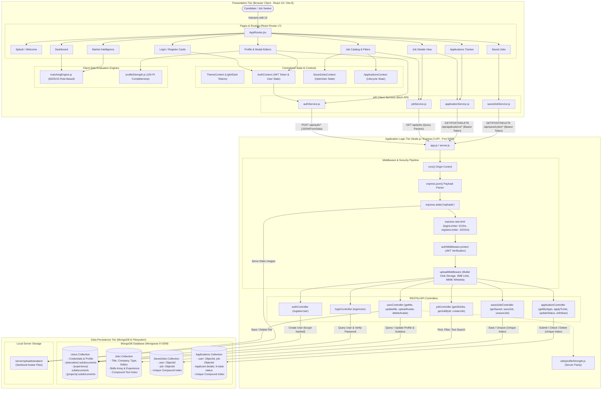
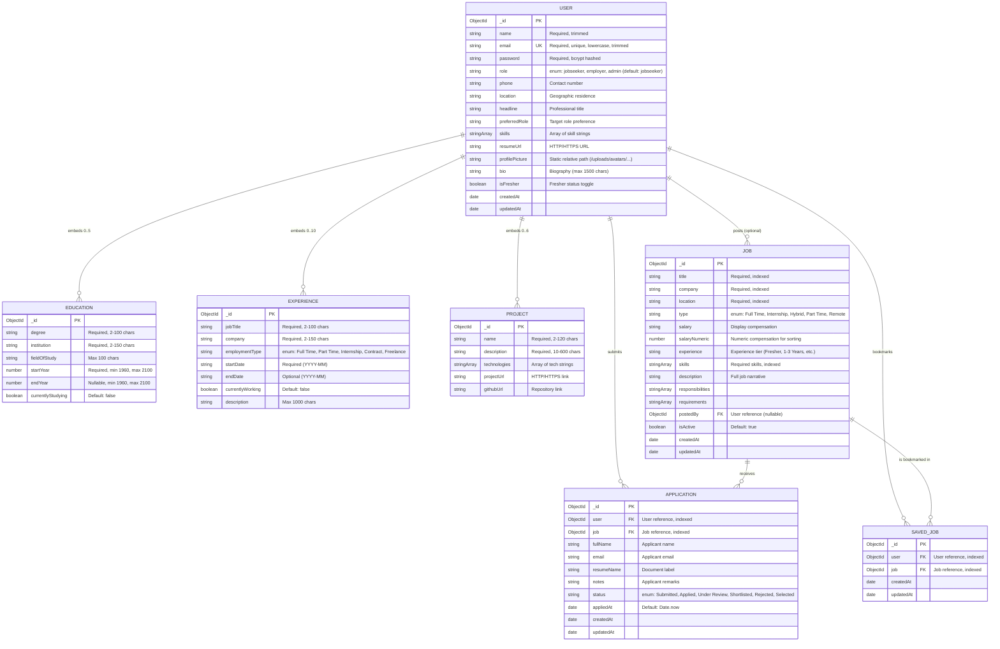

# CareerVista — System Architecture & Technical Specification

**Platform Identity:** CareerVista — Job Market Intelligence & Career Recommendation Platform
**Architecture Document Version:** 1.0 (Verified Codebase Blueprint)
**Academic Context:** Technical Specification & System Architecture Documentation
**Target Environment:** MERN Architecture (React 19, Vite 8, Node.js, Express 5, MongoDB / Mongoose 9)

---

## 1. Executive Summary & Architectural Objectives

CareerVista is a full-stack, distributed web platform engineered to eliminate opacity in early-career recruitment. Traditional Applicant Tracking Systems (ATS) and commercial job aggregation portals rely on uncalibrated keyword heuristics, proprietary machine learning models, or sponsored listing priorities. These opaque mechanisms obscure decision criteria and fail to provide actionable feedback to job seekers regarding technical skill deficiencies.

To address these challenges, CareerVista implements a **decoupled, 3-tier distributed architecture** centered around:
1. **Explainable Algorithmic Matching:** A deterministic, 100-point scoring algorithm evaluating candidate-job alignment across three weighted dimensions: **Technical Skills (60%)**, **Preferred Role Alignment (25%)**, and **Location Compatibility (15%)**.
2. **Profile Completeness Evaluation:** A standalone 100-point rubric assessing candidate profiles across four developmental categories (Identity, Professional Positioning, Technical Validation, and Background History) mapped to five progression milestone tiers.
3. **Stateless RESTful Processing:** A modular API architecture featuring token-based authentication (RFC 7519 JWT), salted password hashing (bcrypt), IP-level rate limiting, multipart media validation, and compound database indexing.

---

## 2. Verified Technology Stack

All framework and runtime versions have been verified directly against `client/package.json` and `server/package.json`:

| Tier | Component / Dependency | Verified Version | Purpose & Architectural Responsibility |
| :--- | :--- | :--- | :--- |
| **Presentation (Frontend)** | **React** | `^19.2.7` | Reactive component library utilizing React 19 hooks and concurrent rendering |
| | **React DOM** | `^19.2.7` | DOM rendering and reconciliation target for React |
| | **Vite** | `^8.1.1` | Next-generation frontend build tool and Hot Module Replacement (HMR) dev server |
| | **React Router DOM** | `^7.18.1` | Client-side declarative routing, protected route guards, and URL parameters |
| | **Framer Motion** | `^12.42.2` | Declarative UI animations, modal transitions, and interactive micro-interactions |
| | **Lucide React** | `^1.27.0` | Modern, accessible SVG UI iconography |
| | **React Icons** | `^5.7.0` | Extended icon sets (FontAwesome, Material Design) for domain indicators |
| | **Styling** | Custom Vanilla CSS | Design token architecture via CSS custom properties (`:root` theme variables) |
| **Application (Backend)** | **Node.js** | `>= 20.x` | Asynchronous, event-driven JavaScript runtime engine (CommonJS module system) |
| | **Express** | `^5.2.1` | HTTP server framework, routing pipeline, middleware orchestration, and static file serving |
| | **Mongoose** | `^9.9.5` | Object Data Modeling (ODM) layer for MongoDB, schema casting, validation, and hooks |
| | **jsonwebtoken** | `^9.0.3` | HMAC SHA-256 token signing and verification for stateless session management |
| | **bcryptjs** | `^3.0.3` | Key derivation function implementing 10-round salted password hashing |
| | **multer** | `^2.4.0` | Middleware for handling `multipart/form-data` file uploads with disk storage |
| | **express-rate-limit** | `^8.7.0` | IP-based request throttling against brute-force attacks and abuse on auth routes |
| | **cors** | `^2.8.6` | Cross-Origin Resource Sharing middleware enabling safe browser communication |
| | **dotenv** | `^17.4.2` | Zero-dependency environment variable configuration loader |
| | **nodemon** (Dev) | `^3.1.14` | Development file-watcher and automatic server restarting utility |
| **Persistence (Database)** | **MongoDB Atlas / Local** | Community / Atlas M0 | Scalable NoSQL document database providing JSON-like BSON persistence and compound indexes |

---

## 3. High-Level System Architecture

CareerVista follows a **3-Tier Distributed Architecture** separating the Presentation Tier (Browser Client), Application Logic Tier (REST API Server), and Data Persistence Tier (Database & Disk Storage).



---

## 4. Component Responsibilities & Subsystem Workflows

### 4.1 Presentation Tier (React 19 / Vite 8)

The frontend client operates as a Single-Page Application (SPA) structured around modular functional components, hooks, and context providers:

1. **State & Context Hierarchy (`client/src/main.jsx`):**
   ```
   <StrictMode>
     <ThemeProvider>
       <AuthProvider>
         <SavedJobsProvider>
           <ApplicationsProvider>
             <App />
           </ApplicationsProvider>
         </SavedJobsProvider>
       </AuthProvider>
     </ThemeProvider>
   </StrictMode>
   ```
   - **`ThemeProvider`:** Controls light/dark mode by reading and updating the `data-theme` attribute on the root DOM element and synchronizing with `localStorage`.
   - **`AuthProvider`:** Reads the stored token and user profile on mount, verifies the session against `GET /api/auth/me`, and provides `login()`, `logout()`, and `updateUser()`.
   - **`SavedJobsProvider`:** Maintains user bookmark state with optimistic client-side updates (instant badge toggle) backed by API synchronization and error rollback.
   - **`ApplicationsProvider`:** Synchronizes submitted applications, provides `applyToJob()` with duplicate checks, exposes `hasApplied(jobId)`, and enables application withdrawal.

2. **Page Modules (`client/src/pages/`):**
   - **`Splash.jsx` & `Welcome.jsx`:** Public onboarding landing pages introducing platform capabilities.
   - **`Login.jsx` & `Register.jsx`:** Authenticated access cards with frontend regular expression validation, password complexity guidelines, and error toast alerts.
   - **`Dashboard.jsx`:** Candidate central cockpit integrating `StatsCard`, `TrendingSkills`, `RecentJobs`, and the `RecommendedJobsSection`.
   - **`Profile.jsx`:** Full profile editor managing personal identity, contact data, bio, headline, skills, resume URL, profile avatar upload/removal, and modal-based management for `EducationModal`, `ExperienceModal`, and `ProjectModal`.
   - **`Jobs.jsx`:** Multi-criteria job catalog featuring `SearchBar`, `FilterPanel` (filters for location, employment type, experience level, salary/company sorting), and `JobCard` grid.
   - **`JobDetails.jsx`:** Comprehensive job description view rendering company details, compensation, responsibilities, requirements, and triggering `ApplyModal`.
   - **`SavedJobs.jsx`:** Dedicated bookmarking management view with unsave capabilities and direct links to job details.
   - **`Applications.jsx`:** Real-time application tracking dashboard with lifecycle status badges (`Submitted`, `Under Review`, `Shortlisted`, `Selected`, `Rejected`) and application withdrawal.
   - **`Analytics.jsx`:** Dynamic recruitment intelligence dashboard calculating real-time skill demand across live database listings, application conversion rates, and compatibility distributions.

---

### 4.2 Application Logic Tier (Express 5 / Node.js)

The backend exposes a stateless RESTful API adhering to HTTP standards:

1. **Middleware Pipeline (`server/src/app.js`):**
   - **`cors()`:** Permits cross-origin requests from the client dev server and production origins.
   - **`express.json()`:** Parses incoming JSON request bodies.
   - **`express.static("/uploads")`:** Statically serves uploaded candidate avatar images from `server/uploads/avatars/`.
   - **Rate Limiting (`express-rate-limit`):**
     - `loginLimiter`: Maximum 5 requests per 15-minute window per IP.
     - `registerLimiter`: Maximum 10 requests per 15-minute window per IP.
   - **`authMiddleware.protect` (`server/src/middleware/authMiddleware.js`):**
     - Extracts the `Authorization` header (`Bearer <token>`).
     - Verifies token validity using `jwt.verify()` against `process.env.JWT_SECRET`.
     - Injects `req.user = { userId, role }` into the request pipeline or returns HTTP 401 Unauthorized.
   - **`uploadMiddleware.uploadAvatar` (`server/src/middleware/uploadMiddleware.js`):**
     - Configures Multer disk storage targeting `server/uploads/avatars/`.
     - Generates unique filenames: `avatar-${userId}-${Date.now()}-${random}${ext}`.
     - Restricts MIME types: `image/jpeg`, `image/png`, `image/webp`.
     - Restricts extensions: `.jpg`, `.jpeg`, `.png`, `.webp`.
     - Enforces maximum file size of 3 MB (`3 * 1024 * 1024`).
     - Returns clean JSON errors on file size or MIME violations.

2. **REST API Endpoint Directory:**

| Method | Endpoint | Access | Middleware | Controller Action & Description |
| :--- | :--- | :--- | :--- | :--- |
| `POST` | `/api/auth/register` | Public | `registerLimiter` | Validates input (regex, 8-72 char password complexity), checks email uniqueness, hashes password (bcrypt 10 rounds), creates User |
| `POST` | `/api/auth/login` | Public | `loginLimiter` | Validates credentials, checks password match (`bcrypt.compare`), signs JWT (7-day lifespan), returns token + user object |
| `GET` | `/api/auth/me` | Private | `protect` | Retrieves current authenticated candidate profile and subdocuments |
| `PUT` | `/api/auth/me` | Private | `protect` | Updates candidate profile attributes and embedded subdocuments (`education`, `experience`, `projects`) |
| `POST` | `/api/auth/profile-picture` | Private | `protect`, `uploadAvatar` | Uploads avatar to disk, deletes prior avatar file if existing, updates `user.profilePicture` |
| `DELETE` | `/api/auth/profile-picture` | Private | `protect` | Deletes avatar from disk and resets `user.profilePicture` to empty string |
| `GET` | `/api/jobs` | Public | None | Lists active jobs with optional query filtering (`search`, `location`, `type`, `experience`, `sort`) |
| `GET` | `/api/jobs/:id` | Public | None | Retrieves a single active job document by validated MongoDB ObjectId |
| `POST` | `/api/jobs` | Private | `protect` | Creates a new job posting (used by admin/employers; seeded initially) |
| `GET` | `/api/saved-jobs` | Private | `protect` | Retrieves all saved jobs for current user (populates `job` document) |
| `POST` | `/api/saved-jobs/:jobId` | Private | `protect` | Bookmarks a job (enforces compound unique index `{ user, job }`) |
| `DELETE` | `/api/saved-jobs/:jobId` | Private | `protect` | Removes a job from candidate's saved list |
| `GET` | `/api/applications` | Private | `protect` | Retrieves all applications submitted by candidate (populates `job`) |
| `POST` | `/api/applications/:jobId` | Private | `protect` | Submits an application (prevents duplicate submissions via compound unique index) |
| `GET` | `/api/applications/:id` | Private | `protect` | Retrieves details of a specific application record |
| `PUT` | `/api/applications/:id` | Private | `protect` | Updates application status (`Submitted`, `Under Review`, `Shortlisted`, `Rejected`, `Selected`) |
| `DELETE` | `/api/applications/:id` | Private | `protect` | Withdraws and deletes an application record |
| `GET` | `/api/health` | Public | None | Service liveness healthcheck endpoint (`{ success: true, message: "CareerVista API is running" }`) |

---

## 5. Database Architecture & Data Modeling

CareerVista utilizes MongoDB with Mongoose 9 ODM. Entities are designed using a hybrid schema combining normalized collection references for high-volume transactions with embedded subdocuments for candidate profile sub-structures.



### 5.1 Database Indexes & Integrity Constraints

1. **`User` Collection:**
   - Unique Index: `{ email: 1 }` (ensures single account per email address).
2. **`Job` Collection:**
   - Compound Text Index: `{ title: "text", company: "text", location: "text", skills: "text" }` (powers keyword search).
3. **`Application` Collection:**
   - Single-field Index: `{ user: 1 }` and `{ job: 1 }` (accelerates user and job lookups).
   - Compound Unique Index: `{ user: 1, job: 1 }` (guarantees that a user can only apply once to any given job vacancy; duplicate attempts trigger HTTP 409 Conflict).
4. **`SavedJob` Collection:**
   - Single-field Index: `{ user: 1 }` and `{ job: 1 }`.
   - Compound Unique Index: `{ user: 1, job: 1 }` (prevents redundant bookmarking of the same vacancy).

---

## 6. Algorithmic Matching & Scoring Methodology

CareerVista rejects opaque "black-box" recruitment scoring in favor of a **deterministic, explainable rule-based algorithm** implemented in `client/src/utils/matchingEngine.js`.

### 6.1 Profile-Readiness Eligibility Gate

Before executing similarity computations, the engine evaluates whether the candidate has provided sufficient baseline criteria:
$$\text{isMatchReady}(user) = \Big(\text{skills.length} \ge 1\Big) \land \Big(\text{preferredRole.trim().length} > 0\Big)$$

- **Unready State:** If the candidate lacks recorded skills or a preferred role, the engine immediately returns a score of `0`, assigns the label `"Profile Incomplete"`, sets `isMatchReady: false`, and prompts the candidate via the UI to complete their profile.
- **Ready State:** When the gate evaluates to `true`, the candidate is evaluated across all three weighted dimensions.

### 6.2 Mathematical Scoring Dimensions

The total match score $S_{\text{total}} \in [0, 100]$ is computed as the sum of three independent scoring dimensions:

$$S_{\text{total}} = S_{\text{skills}} + S_{\text{role}} + S_{\text{location}}$$

#### Dimension 1: Technical Skills Match ($S_{\text{skills}} \in [0, 60]$ — 60% Weight)
- Candidate skills and job skills are normalized: lowercased, whitespace-trimmed, and deduplicated.
- Skill overlap utilizes bidirectional inclusion matching:
  $$\text{match}(s_u, s_j) \iff (s_u = s_j) \lor (s_u \subset s_j) \lor (s_j \subset s_u)$$
- Formula:
  $$S_{\text{skills}} = \text{round}\left( \frac{|\mathcal{S}_{\text{matched}}|}{|\mathcal{S}_{\text{job}}|} \times 60 \right)$$
- **Edge Cases:**
  - If the candidate has skills but the job posting lists zero explicit skills, a neutral score of $30$ points is awarded.
  - If the candidate has zero skills, $S_{\text{skills}} = 0$.

#### Dimension 2: Preferred Role Alignment ($S_{\text{role}} \in [0, 25]$ — 25% Weight)
- The candidate's `preferredRole` (or `headline` as fallback) is normalized and compared against the job's `title`.
- Direct match (exact or substring):
  $$\text{if } (T_{\text{job}} \subset R_{\text{user}}) \lor (R_{\text{user}} \subset T_{\text{job}}) \implies S_{\text{role}} = 25$$
- Token overlap match (e.g., `"Frontend Developer"` vs. `"Senior Frontend Engineer"`):
  $$S_{\text{role}} = \max\left(15, \, \text{round}\left(\frac{|\mathcal{T}_{\text{common}}|}{|\mathcal{T}_{\text{userRole}}|} \times 25\right)\right)$$
- If no token overlap exists or candidate role is empty: $S_{\text{role}} = 0$.

#### Dimension 3: Location Compatibility ($S_{\text{location}} \in [0, 15]$ — 15% Weight)
- Evaluates candidate location preference against job location and job type:
  - If job location, job type, or candidate location contains `"remote"`: $S_{\text{location}} = 15$.
  - If candidate specifies no location preference: $S_{\text{location}} = 15$ (non-penalizing for flexible candidates).
  - If on-site locations match or contain each other: $S_{\text{location}} = 15$.
  - If on-site locations mismatch: $S_{\text{location}} = 0$.

### 6.3 Compatibility Bands & Explainability Feedback

Total score $S_{\text{total}}$ maps to four standardized compatibility bands:

| Score Range | Compatibility Band | Badge Presentation | Recommended Candidate Action |
| :--- | :--- | :--- | :--- |
| **80 – 100** | **Strong Match** | Green Badge (`#15803d`, `#f0fdf4`) | High priority application; immediate candidacy fit |
| **60 – 79** | **Good Match** | Blue Badge (`#1d4ed8`, `#eff6ff`) | Strong fit with minor skill gaps easily bridged |
| **40 – 59** | **Partial Match** | Amber Badge (`#b45309`, `#fffbeb`) | Moderate alignment; candidate should review required skills |
| **0 – 39** | **Low Match** | Slate Badge (`#475569`, `#f8fafc`) | Significant divergence in core technical proficiencies or role |

**Explainability Feedback:** Alongside the numeric score, the engine computes:
- $\mathcal{S}_{\text{matched}}$: An array of skills successfully matched to the job posting.
- $\mathcal{S}_{\text{missing}}$: An array of job requirements the candidate currently lacks, rendered directly in the user interface as actionable feedback.

---

## 7. Profile-Strength Methodology

Candidate profile strength is computed independently of job matching via `client/src/utils/profileStrength.js` and `server/src/utils/profileStrength.js`. The 100-point rubric evaluates 12 criteria across 4 categories:

| Category | Criterion | Max Points | Evaluation Rule / Validation Guard |
| :--- | :--- | :---: | :--- |
| **1. Identity & Contact (20 Pts)** | Full Name | 5 | String length $\ge 2$ characters |
| | Email Address | 5 | Valid email matching standard regex format |
| | Contact Phone | 5 | String length $\ge 7$ digits/characters |
| | Location | 5 | String length $\ge 2$ characters |
| **2. Professional Positioning (20 Pts)** | Headline | 5 | String length $\ge 5$ characters |
| | Preferred Role | 10 | String length $\ge 2$ characters |
| | Bio Summary | 5 | String length $\ge 30$ characters |
| **3. Technical Validation (35 Pts)** | Skills List | 15 | Tiered scoring: 1–2 skills = 5 pts; 3–4 skills = 10 pts; $\ge 5$ skills = 15 pts |
| | Featured Projects | 10 | $\ge 1$ project record with valid name and description |
| | Resume Link | 10 | Non-empty valid HTTP or HTTPS URL syntax |
| **4. History & Background (25 Pts)** | Education History | 15 | $\ge 1$ education record with degree, institution, and valid startYear |
| | Experience History | 10 | $\ge 1$ experience record with jobTitle and company **OR** `isFresher === true` |
| **Total Completeness Score** | | **100** | Sum of earned points across all 12 criteria |

### 7.1 Milestone Progression Tiers

The profile strength score maps directly to five milestone progression tiers:
- **90 – 100:** `"All-Star Profile"` (Maximum market visibility, complete portfolio)
- **75 – 89:** `"Advanced Profile"` (Strong candidacy presentation)
- **50 – 74:** `"Intermediate"` (Core credentials recorded; background details needed)
- **25 – 49:** `"Basic Profile"` (Preliminary account setup)
- **0 – 24:** `"Getting Started"` (Minimal baseline identity)

---

## 8. Security & Data Protection Controls

CareerVista implements defense-in-depth across the application lifecycle:

1. **Stateless JWT Authentication:**
   - Tokens are issued upon successful credential verification with a 7-day lifespan.
   - Tokens contain claims `{ userId: user._id, role: user.role }` signed with HMAC SHA-256 via `JWT_SECRET`.
   - Protected routes inspect `Authorization: Bearer <token>`; invalid or expired tokens trigger HTTP 401.
2. **Salted Password Hashing:**
   - Passwords are encrypted using `bcryptjs` with 10 salt rounds prior to persistence.
   - Registration enforces strict complexity: 8–72 characters, uppercase letter, lowercase letter, number, and special character.
3. **Brute-Force Rate Limiting:**
   - Backed by `express-rate-limit` tracking IP addresses in memory.
   - `/api/auth/login` restricted to 5 attempts per 15 minutes.
   - `/api/auth/register` restricted to 10 attempts per 15 minutes.
4. **Multipart Media Upload Security:**
   - Multer disk storage writes files exclusively to `server/uploads/avatars/`.
   - MIME validation enforces `image/jpeg`, `image/png`, `image/webp`.
   - File extension whitelisting prevents executable uploads (`.jpg`, `.jpeg`, `.png`, `.webp`).
   - File size ceiling of 3 MB (`3 * 1024 * 1024` bytes).
   - Filenames are randomized with timestamps and random integers to prevent path traversal or file overwrites.
   - Existing avatar files are deleted from disk upon upload of a replacement or explicit deletion.
5. **NoSQL Query & Input Sanitization:**
   - Search queries undergo regex escaping via `escapeRegex()` helper to prevent ReDoS attacks.
   - MongoDB ObjectIds are strictly validated via `mongoose.Types.ObjectId.isValid()` before querying.
   - Strict payload whitelisting in `userController.updateCurrentUser` prevents unauthorized field modification.

---

## 9. Installation, Setup & Environment Configuration

### 9.1 Prerequisites
- **Node.js:** v20.x or higher (LTS recommended)
- **npm:** v10.x or higher
- **MongoDB:** Local MongoDB daemon (v6.x+) or active MongoDB Atlas connection URI

### 9.2 Repository Setup Instructions

```bash
# Clone the repository
git clone <repository_url>
cd CareerVista

# ----------------------------------------------------
# 1. Backend Server Configuration
# ----------------------------------------------------
cd server
npm install

# Configure environment variables (create .env from .env.example)
cp .env.example .env
# Edit .env with your local settings (see Environment Variables below)

# Seed database with sample active job vacancies
node src/scripts/seedJobs.js

# Launch backend in development mode (runs on http://localhost:5000)
npm run dev

# ----------------------------------------------------
# 2. Frontend Client Configuration (New Terminal)
# ----------------------------------------------------
cd ../client
npm install

# Configure frontend environment variables
cp .env.example .env
# Ensure VITE_API_URL matches backend URL (http://localhost:5000)

# Launch Vite development server (runs on http://localhost:5173)
npm run dev
```

### 9.3 Environment Variable Specifications

#### Backend Environment Variables (`server/.env`)
```ini
# Server Execution Port
PORT=5000

# Node Environment Mode (development | production)
NODE_ENV=development

# MongoDB Connection String (Atlas URI or Local Instance)
MONGO_URI=mongodb://localhost:27017/careervista

# JWT Secret Key for Token HMAC SHA-256 Signing
JWT_SECRET=your_jwt_secret_key_change_in_production
```

#### Frontend Environment Variables (`client/.env`)
```ini
# Backend API Base URL
VITE_API_URL=http://localhost:5000
```

---

## 10. Operational Boundaries & Future Roadmap

To preserve academic integrity, current operational limitations and deferred capabilities are documented below:

1. **Local Media Persistence:** Avatar uploads are currently stored on the local server filesystem (`server/uploads/avatars`). Future iterations will transition to distributed S3-compatible cloud object storage (e.g., AWS S3, Cloudinary).
2. **Resume OCR & Parsing:** Candidate resumes are presently linked via valid HTTP/HTTPS URLs. Direct PDF parsing via Optical Character Recognition (OCR) and NLP skill extraction represents a planned enhancement.
3. **Employer Vacancy Interface:** While the database schema and backend route (`POST /api/jobs`) support job creation, the frontend user experience is currently tailored to candidate job seekers. An employer-facing portal is planned for enterprise iterations.
4. **Email Notification Pipeline:** Application status modifications update the database in real time; automated email dispatch via SMTP (SendGrid/Nodemailer) is currently deferred.
